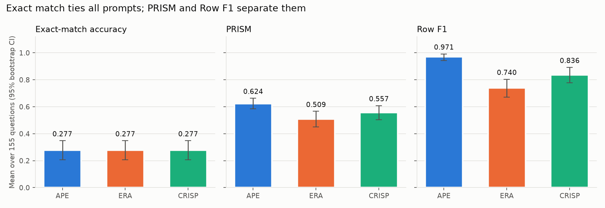
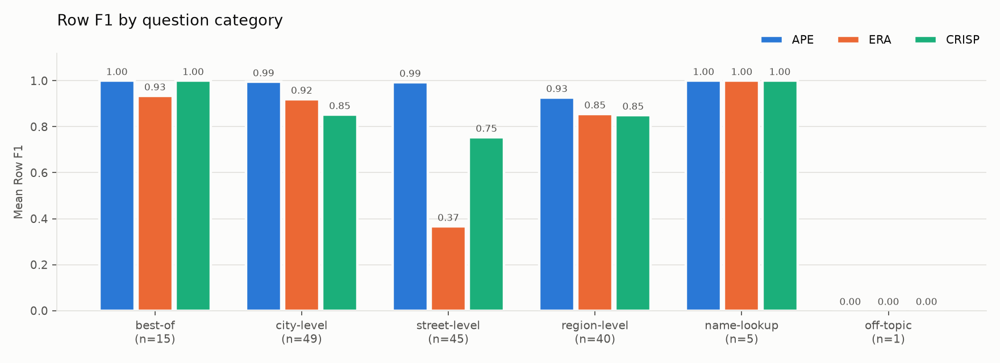
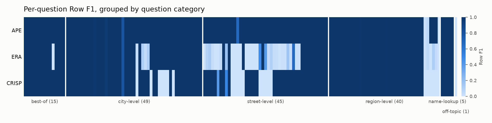
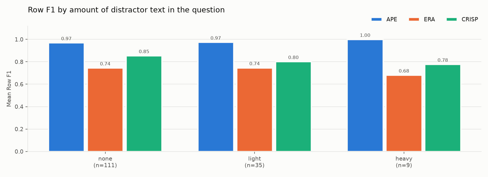

# Task 4 – Detailed comparison of the APE, ERA and CRISP prompts

**Setup.** Three prompts were written in Task 1 using the APE, ERA and CRISP
frameworks. Each was run once, in a fresh session of the **GitHub Copilot
agent** (agent mode in VS Code), on the 155 natural-language questions in
`restaurants_dataset.csv`. The underlying LLM selected in Copilot was not
recorded. Every question has a gold result set from the Restaurants
text-to-SQL database.

**Metrics.**
* **EX**: the original exact execution match.
* **PRISM**: the Task 3 metric, together with its two factors, **RowF1**
  (were the right restaurants returned?) and **ColF1** (were the right
  columns selected?).

**Reproduce.** Run `python ../Task_3/prism_metric.py`, then
`python analysis.py`. The analysis needs `numpy`, `scipy` and `matplotlib`.
Outputs are written to `results/` and `figures/`.

---

## 1. Headline results

| Prompt | EX [95 % CI] | **PRISM** [95 % CI] | RowF1 [95 % CI] | ColF1 | Full answer (RowF1 = 1) |
|---|---|---|---|---:|---:|
| **APE** | 0.277 [0.206, 0.348] | **0.624** [0.586, 0.663] | **0.971** [0.942, 0.992] | 0.632 | **143 / 155** |
| ERA | 0.277 [0.206, 0.348] | 0.509 [0.451, 0.566] | 0.740 [0.672, 0.804] | 0.600 | 106 / 155 |
| CRISP | 0.277 [0.206, 0.348] | 0.557 [0.504, 0.609] | 0.836 [0.778, 0.892] | 0.561 | 123 / 155 |

The confidence intervals are percentile bootstraps with 10,000 resamples of
the questions.

**Key observations**

1. **EX cannot rank the prompts.** All three are correct on exactly the same
   43 questions: the ones whose gold answer is empty. The gold rows are
   `(HOUSE_NUMBER, NAME)` while every prompt produced `(ID, NAME)`, so no
   non-empty answer can ever match (see the Task 3 report).
2. **PRISM and RowF1 give a clear ordering: APE > CRISP > ERA.** APE
   returned exactly the right set of restaurants for 92 % of questions. The
   only thing it lacked was the `HOUSE_NUMBER` column the benchmark expects.
3. **ColF1 is about the same for all three prompts.** On every question with
   rows on both sides it equals 0.5 for all of them; the column error is
   shared. Its mean differs only because empty-versus-non-empty cases score 0
   or 1. The prompts therefore differ in **which rows they retrieve**, not in
   **which columns they select**.

## 2. Is the difference statistically significant?

The same 155 questions were answered by every prompt, so all tests are
**paired** (repeated measures per question). The tests are non-parametric
because the scores are bounded, heavily tied and bimodal. The three pairwise
comparisons are corrected for multiple testing with the Holm method.

### 2.1 Omnibus tests (are the three prompts different at all?)

| Score | Test | Statistic | p-value | Effect size |
|---|---|---|---|---|
| EX (binary) | Cochran's Q | Q = 0.0 | **1.0** | none: identical answer vectors |
| Full answer (RowF1 = 1, binary) | Cochran's Q | Q = 45.7 | **1.2 × 10⁻¹⁰** | – |
| PRISM | Friedman | χ² = 41.4 | **1.0 × 10⁻⁹** | Kendall's W = 0.13 (0.18 on non-empty gold) |
| RowF1 | Friedman | χ² = 41.4 | **1.0 × 10⁻⁹** | Kendall's W = 0.13 |

PRISM and RowF1 give identical Friedman statistics because, within a
question, PRISM = ½ · RowF1 for every prompt whenever rows are returned, so
the ranks are the same.

### 2.2 Pairwise tests on PRISM

| Pair | Mean Δ PRISM [95 % bootstrap CI] | Wins / losses / ties | Wilcoxon p (Holm) | Sign-flip permutation p (Holm) | Rank-biserial r |
|---|---|---|---|---|---|
| APE − ERA | **+0.115** [0.084, 0.148] | 39 / 0 / 116 | **1.5 × 10⁻⁷** | **3 × 10⁻⁴** | 1.00 |
| APE − CRISP | **+0.067** [0.042, 0.095] | 24 / 0 / 131 | **1.3 × 10⁻⁵** | **3 × 10⁻⁴** | 1.00 |
| ERA − CRISP | −0.048 [−0.082, −0.014] | 18 / 27 / 110 | 0.093 | **0.0056** | −0.29 |

The permutation p of 3 × 10⁻⁴ is the smallest value reachable with 10,000
permutations, Holm-adjusted.

The RowF1 differences are exactly twice as large with the same test outcomes:
APE − ERA = +0.231, APE − CRISP = +0.134 and ERA − CRISP = −0.096
(CI [−0.165, −0.029]).

### 2.3 Pairwise McNemar tests on "full answer" (RowF1 = 1)

| Pair | Only first correct | Only second correct | Exact p (Holm) |
|---|---:|---:|---|
| APE vs ERA | 37 | 0 | **4.4 × 10⁻¹¹** |
| APE vs CRISP | 20 | 0 | **3.8 × 10⁻⁶** |
| CRISP vs ERA | 25 | 8 | **0.0046** |

### 2.4 Verdict

* **APE is significantly better than both ERA and CRISP**, by every test. It
  is never worse than either on a single question (39–0 and 24–0). This is
  the strongest possible paired result: a rank-biserial r of 1.0.
* **CRISP is better than ERA with moderate evidence.** The mean difference,
  the bootstrap CI (which excludes 0), the permutation test and McNemar are
  all significant. The Wilcoxon signed-rank test is not (p = 0.09). The two
  prompts fail on *different* questions: CRISP wins 27 times, ERA 18 times.
  CRISP's wins are larger on average (0.45 vs 0.26 PRISM). However, 8 of
  ERA's wins are maximum-size (0.5) and tie for the top ranks, so ranking
  compresses CRISP's advantage in magnitude. A plain sign test, which ignores
  magnitude completely, gives p = 0.23. The ordering CRISP > ERA therefore
  depends on how much weight the size of each win gets. It holds for these
  outputs but is much less robust than APE's lead.
* **With EX alone, the conclusion would be "no difference" (p = 1).** That
  conclusion is wrong, and it is an artefact of the metric.

> **Scope of the inference.** These tests treat *questions* as the random
> sample. They show that, for these three generated files, the differences
> are not due to which questions happened to be asked. They do **not** show
> that the APE framework is better in general. Each prompt was run once, so
> run-to-run variance of the agent is confounded with the prompt effect
> (see §5.4).

## 3. Where do the differences come from?

### 3.1 By question category

| Category | n | APE | ERA | CRISP | Friedman p (RowF1) |
|---|---:|---:|---:|---:|---|
| best-of ("what is the best X in Y") | 15 | 1.00 | 0.93 | 1.00 | 0.37 |
| city-level ("restaurants in <city> …") | 49 | 0.99 | 0.92 | 0.85 | 0.020 |
| **street-level ("… on <street> in <city> …")** | 45 | **0.99** | **0.37** | **0.75** | **2.3 × 10⁻⁹** (W = 0.44) |
| region-level ("… in the bay area …") | 40 | 0.93 | 0.85 | 0.85 | 0.0094 |
| name-lookup ("where is <name> in <city>") | 5 | 1.00 | 1.00 | 1.00 | – |
| off-topic ("What is the lifes greates illusion?") | 1 | 0.00 | 0.00 | 0.00 | – |

The values are mean RowF1. The full PRISM-by-category values are in
`results/analysis_results.json`.

**Street-level questions account for most of the gap.** This is the only
category with a large effect (Kendall's W = 0.44). The heat-map below shows
the same thing per question. Each column is one question; dark means the
right restaurants were returned.

ERA's failures form a solid block in the street-level section. CRISP's
failures are smaller blocks in the street-level and city-level sections. APE
is almost uniformly dark. Only 12 questions have APE RowF1 below 1, and
apart from #42 (0.67) all of them are failures that every prompt shares:
* #65, the off-topic question, whose gold answer is 2,696 rows.
* #130, "thai in unknown": none of the prompts reproduced the gold
  interpretation of "unknown".
* #115 and #116 ("breakfast food in the bay area", "swiss food in the
  monterey"), where APE and ERA dropped the food type. CRISP scores 0 on
  both too.
* Seven near-misses (RowF1 0.80–0.998) with exactly the same score for all
  three prompts, so they do not affect the comparison.

### 3.2 By amount of distractor text

Many questions are padded with irrelevant sentences (*"…and I have not
settled whether pasta belongs in a lunchbox or a flowerpot?"*). Questions
were labelled by how much text lies outside the core request:
* **none**: 111 questions
* **light**: 35 questions, one distractor clause
* **heavy**: 9 questions, more than 150 extra characters, usually a full
  sentence before and after the request

| Noise | n | APE | ERA | CRISP |
|---|---:|---:|---:|---:|
| none | 111 | 0.968 | 0.743 | 0.853 |
| light | 35 | 0.973 | 0.745 | 0.800 |
| heavy | 9 | 0.998 | 0.680 | 0.776 |
| Kruskal–Wallis across noise levels | | p = 0.83 | p = 0.77 | p = 0.65 |

**Distractor text does not significantly affect any prompt.** The
differences between prompts are the same with and without noise, so the
noise was not what separated them. The one noise-related bug is in CRISP:
three questions (#125, #130, #134) received the SQL of the *next* question,
and each of those next questions starts with a distractor clause. This is
a row-alignment slip, not misunderstanding, and it costs CRISP three
questions.

### 3.3 What the generated SQL actually does

| SQL behaviour | APE | ERA | CRISP |
|---|---:|---:|---:|
| Street-level questions with a street filter (of 45) | **45** | 10 | **45** |
| … of which match the street with `LIKE '%…%'` | **45** | 0 | 0 (exact `=`) |
| Region-level questions that join `GEOGRAPHIC` (of 40) | 39 | **40** | 34 |
| Queries with a *polluted literal* (question text inside a value, e.g. `'san mateo for ice cream food'`) | **0** | 15 | 20 |
| Queries with identical normalised SQL to APE | – | 50 / 155 | 85 / 155 |

Typical failures:

* **ERA drops constraints, causing over-retrieval.** On 35 of the 45
  street-level questions it never filters by street. For *"give me a
  restaurant on san ignacio ave in san jose …"* it returns all 922
  San Jose restaurants. Its "best X in Y" parser also splits the question
  in the wrong place:
  `FOOD_TYPE = 'place' AND CITY_NAME = 'winters for tea food'`.
* **CRISP puts too much into one literal, causing under-retrieval.** For
  *"… on mission blvd in hayward for pizza food …"* it generates
  `CITY_NAME = 'hayward for pizza food'`, which matches nothing.
  *"… in the monterey …"* becomes `CITY_NAME = 'the monterey' AND FOOD_TYPE = 'some swiss'`.
* **APE extracts slots correctly and matches fuzzily.**
  `STREET_NAME LIKE '%noriega%'` tolerates the gap between how a street is
  written in the question and in the database.

## 4. Statistical summary of the error types

| Outcome (of 155) | APE | ERA | CRISP |
|---|---:|---:|---:|
| exact (empty = empty) | 43 | 43 | 43 |
| right rows, wrong columns | **100** | 63 | 80 |
| partial overlap (too many or too few rows) | 10 | **37** | 8 |
| missed rows (empty prediction, gold non-empty) | 2 | 11 | **22** |
| disjoint rows | 0 | 1 | 2 |
| spurious rows (rows returned, gold empty) | 0 | 0 | 0 |

ERA's typical error is **precision** (too many rows). CRISP's typical error
is **recall** (no rows). APE makes few errors of either kind.

## 5. Why the prompts differ: prompt, model and coding agent

### 5.1 The prompt

All three prompts ask for the same thing and share most of their sentences:
copy questions verbatim, use only the schema, check exact values in
`restaurants-db.txt`, output a CSV. The differences are in **framing and
ordering**:

* **APE (Action → Purpose → Expectation)** is the only prompt with a
  **Purpose** section. It states *why* the output matters: "a reference set …
  every SQL query must be correct and executable against this exact
  database, because the pairs will be used to check whether questions are
  translated accurately." Stating the evaluation stakes is a known lever.
  It pushes the agent to check its output against the data instead of
  optimising for format. APE's SQL is the only one that consistently
  verifies values against the data: it uses `LIKE` for free-text streets and
  never leaves question words inside literals.
* **ERA (Expectation → Role → Action)** opens with a full paragraph about the
  **output format**. The task itself only appears in step 3 of the Action
  list. The agent appears to have optimised for the CSV contract (perfect
  quoting, one line per query, `LOWER()` on every comparison) and treated
  the SQL logic as secondary. Its SQL is the most generic, with the fewest
  joins and filters.
* **CRISP (Context → Role → Instructions → Specifics → Parameters)** is the
  longest and most structured prompt. It produced SQL closest to APE (85
  identical queries) but without APE's verification step. Its
  "Match exact values … including the spelling" instruction was implemented
  literally as exact `=` comparison, with no `LIKE` and no stripping of
  surrounding words. That explains its "missed rows" profile.
* **Shared omissions explain the shared ceiling.** No prompt contains an
  example of the expected output row, and none says that a "restaurant"
  answer should include its house number. All three therefore pick `ID, NAME`
  and score EX = 0 on every non-empty question. A single few-shot example
  would probably move all three from EX ≈ 0.28 to EX close to their RowF1
  (0.74–0.97).
* **Unfilled placeholder.** The prompts in `Task_1/prompts.md` still contain
  the literal `[SQL DIALECT]`. If they were sent as written, the agent had to
  guess the dialect. All outputs are valid SQLite, so no query failed to
  execute, but the dialect was left to chance.

### 5.2 The model

The Copilot agent did not record which LLM produced the outputs, so the
model cannot be isolated as a factor. Its visible influence:

* **Shared defaults:** `SELECT ID, NAME`, `ORDER BY RATING DESC LIMIT 1` for
  "best", and `WHERE 1 = 0` for the off-topic question. These reflect the
  model's prior beliefs about what a good answer looks like, and appear
  identically under all three prompts.
* **Semantic competence is not the bottleneck.** When the slots are
  extracted correctly (APE), 92 % of answers are fully right, so the model
  "knows" the SQL. The differences between prompts come from *how the slots
  were extracted*, which points to the agent's working strategy rather than
  the model's SQL knowledge.
* A stronger or different model would probably still miss `HOUSE_NUMBER`,
  because that convention cannot be inferred from the prompt.

### 5.3 The coding agent

The SQL files carry clear signs of **programmatic generation**: the agent
appears to have written a small parser (regular expressions or templates)
and run it over all 155 questions, rather than translating each question
individually. The evidence:

* Within each file, every query follows one or two fixed templates with
  identical alias and spacing style (`R.` in APE, `r.` + `LOWER()` in ERA).
* Some errors are string-slicing artefacts that no LLM reasoning about one
  question would produce: `FOOD_TYPE = 'restaurant on hillsdale mall'`,
  `CITY_NAME = 'winters for tea food'`, and
  `STREET_NAME = 'a separate food note, I cannot choose between noodles and a sandwich, where is a chinese'`.
* The same template mistake repeats across a whole category (ERA on
  street-level questions, CRISP on "… for X food" phrases). Independent
  per-question translations would produce scattered errors instead.
* CRISP's off-by-one rows suggest a split or loop error in a script.

This is the most important explanatory factor. **Each prompt mainly
changed how the agent designed its parser**, and the parser quality decided
the score. APE's purpose statement seems to have led to a more careful,
data-aware parser (`LIKE`, region joins, slot extraction that ignores
distractors). ERA's format-first framing produced the least careful one.
For an agent working on 155 items, "write a script" is a rational shortcut,
but it turns a translation task into a pattern-matching task. That explains
why one template bug costs dozens of questions at once, and why distractor
text (which a regex anchored on keywords skips) did not matter.

### 5.4 Threats to validity

* **One run per prompt.** Agent behaviour is stochastic: the same prompt in
  a new session could produce a different parser. The prompt effect cannot
  be separated from run-to-run variance. Recommendation: at least 3–5
  sessions per prompt, then a mixed model or a Friedman test over run-level
  means.
* **Unknown model and no inference times.** Neither was recorded, so speed
  and model choice cannot be compared. Task 2 asked for timings, but none
  were captured.
* **Label quirks.** The off-topic question has 2,696 gold rows, the gold
  "bay area" query returns 9,171 rows with duplicates, and the projection
  convention is never stated. EX in particular is dominated by these quirks.
  PRISM reduces the effect but does not remove it.
* **Category labels are heuristic** (regex-based; see
  `results/question_categories.csv`). They were checked manually for all 155
  questions.

## 6. Conclusions

1. On the original metric the three prompts are **indistinguishable**
   (EX = 0.277 each, Cochran's Q p = 1.0). This is an artefact of a
   projection mismatch that affects all prompts equally.
2. On PRISM / RowF1 the prompts differ **significantly** (Friedman
   p ≈ 10⁻⁹):
   * **APE (0.624 / 0.971)** is significantly better than **CRISP
     (0.557 / 0.836)** and **ERA (0.509 / 0.740)**, and is never worse on
     any single question.
   * CRISP beats ERA with moderate evidence.
3. The gap comes almost entirely from **street-level questions** (ERA ignores
   the street; CRISP merges words into literals). Distractor text has no
   significant effect.
4. The most plausible cause is the interaction of **prompt framing with the
   coding agent's strategy**. The Copilot agent solved the task by writing a
   parser, and the prompt mainly influenced how careful that parser was.
   APE's explicit *Purpose* ("must be correct and executable against this
   exact database") produced the most data-aware parser.
5. The biggest improvement for every prompt would be the same: **one example
   of the expected output** (house number and name). The next steps are to
   repeat runs to measure agent variance and to record the model and the
   inference time.
