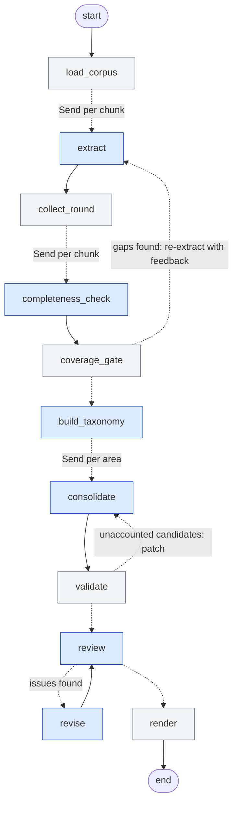

## 1. Overview

The network turns a directory of heterogeneous documents (draft SRS, e-mail threads, interviews, meeting
minutes, surveys, documentation of an existing system) into one structured requirements specification.
It is implemented in **LangGraph** (`requirements_network/graph.py`) and uses the **OpenAI API** through
`langchain-openai`. Nothing is hard-coded to the example corpus: the only input is a directory path, which is
searched recursively for text-like files (`.txt .md .eml .rst .csv .json .html`).

```bash
pip install -r requirements.txt
cp .env.example .env            # add OPENAI_API_KEY (optional per-role model overrides)
python run.py data/corpus       # -> output/requirements.md, output/requirements.json, output/graph.mmd
python run.py data/corpus --model extract=gpt-4.1-nano   # override a role's model from the CLI
```

| Deliverable | File |
|---|---|
| Python implementation | `run.py`, `requirements_network/*.py` |
| This report | `report.md` |
| Generated requirements document | `output/requirements.md` (machine-readable twin: `output/requirements.json`) |
| Graph diagram (Mermaid, exported by LangGraph) | `output/graph.mmd` |

## 2. Architecture



Blue nodes call an LLM, grey nodes are deterministic Python. Dashed edges are conditional edges; "Send"
edges fan out into parallel tasks (LangGraph `Send` API, map-reduce), and the following node acts as the
barrier that waits for all of them.

### 2.1 Nodes

| # | Node | Kind | Model | Responsibility |
|---|---|---|---|---|
| 1 | `load_corpus` | deterministic | – | Recursively finds documents, parses e-mails, detects each document's date (file name → `Date:` header → first long-form date), assigns document IDs `D01…`, splits documents into ≤12k-character chunks on paragraph boundaries. |
| 2 | `extract` | LLM, parallel per chunk | gpt-5-mini | Extracts every explicit and implicit requirement as an atomic "The system shall…" candidate, with a verbatim quote, category hint, type, priority evidence, stakeholder and a *suspicious* flag. |
| 3 | `collect_round` | deterministic | – | Barrier after the parallel extraction; checks deterministically whether each quote really occurs in the source text (fuzzy matching) to flag hallucinated evidence. |
| 4 | `completeness_check` | LLM, parallel per chunk | gpt-5.4-nano | Independent auditor: compares the chunk with what was extracted from it and lists missed requirements with quotes. |
| 5 | `coverage_gate` | deterministic | – | Decides loop 1: chunks with gaps are re-extracted with the auditor's findings as feedback (max 2 extra rounds). Gaps still reported after the last round are turned directly into candidates (safety net). |
| 6 | `build_taxonomy` | LLM | gpt-5.6-luna | Sees all candidates at once; defines the system summary, 5–12 functional areas (with codes used in IDs), a glossary of canonical terms with synonyms to avoid, and assigns every candidate to an area. Missing assignments are repaired deterministically. |
| 7 | `consolidate` | LLM, parallel per area | gpt-6-luna | Merges semantic duplicates, writes name + one-paragraph description, normalises vocabulary to the glossary, resolves conflicts (newer/more authoritative source wins), assigns priority with rationale, and moves losers/nonsense into the discarded list with an explanation. |
| 8 | `validate` | deterministic | – | Assigns stable IDs `REQ-<AREA>-<NNN>`, checks that **every candidate** is either inside a requirement or discarded (loop 2 sends unaccounted candidates back to `consolidate` in *patch* mode), computes source documents per requirement, runs lint checks. |
| 9 | `review` | LLM critic + lint | gpt-5.6-luna | Reviews the whole specification across areas for duplicates, conflicts, terminology, vagueness, priority and format issues; deterministic lint findings are merged in. |
| 10 | `revise` | LLM | gpt-6-luna | Fixes review issues through structured operations (`updates`, `merges`, `removals`) that are applied deterministically, so IDs and traceability are preserved. Loop 3 returns to `review` (max 2 revisions). |
| 11 | `render` | deterministic | – | Writes the Markdown document and the JSON twin (including all candidates, quotes, review history and token usage). |

### 2.2 Feedback loops

1. **Extraction ↔ completeness check** (`extract → collect_round → completeness_check → coverage_gate → extract`).
   A second, *different* model audits the first one, so their blind spots are less correlated. Only chunks with
   gaps are re-processed, and the extractor receives both the list of missed items and what it already
   extracted (to avoid duplicates).
2. **Consolidation ↔ coverage validation** (`consolidate → validate → consolidate`). The checker is
   deterministic: set arithmetic over candidate IDs proves that no extracted statement was silently dropped.
   Unaccounted candidates are sent back to the area's consolidator together with the existing requirements of
   that area, so it can attach them to an existing requirement, create a new one, or discard them with a reason.
3. **Review ↔ revise** (`review → revise → review`). A critic with a global view catches what per-area
   consolidation cannot: duplicates and contradictions *across* areas, inconsistent vocabulary, and priority
   inconsistencies. The loop stops when the reviewer approves or after the iteration limit; findings that are
   still open are listed in the appendix of the document instead of being hidden.

All loop limits are configurable (`RN_MAX_EXTRACTION_ROUNDS`, `RN_MAX_CONSOLIDATION_ROUNDS`, `RN_MAX_REVIEW_ROUNDS`).

### 2.3 Model choice (ANS4)

| Role | Model | Reasoning |
|---|---|---|
| extract | gpt-5-mini | ~22 parallel calls over raw text; needs good recall at a low price. |
| completeness | gpt-5.4-nano | Narrow yes/no-style audit task; a cheap model from a different family than the extractor gives an independent second opinion. |
| taxonomy, review | gpt-5.6-luna | Global view over hundreds of short statements; needs a large-context, strong model but produces little output. |
| consolidate, revise | gpt-6-luna | The hardest reasoning: semantic deduplication, conflict resolution, prioritisation and writing quality. |

Every role can be switched to another model via `.env` (`RN_MODEL_<ROLE>`) or `--model role=model`.
All LLM outputs use **OpenAI strict JSON-schema structured output** (Pydantic models in `schemas.py`), so the
deterministic nodes can rely on the shape of the data; unparseable answers are retried.

## 3. How each output specification is addressed

| Spec | Where it is addressed |
|---|---|
| **OS1** Single structured document | `render` writes one Markdown document with fixed sections: introduction, sources, priority scale, glossary, overview, detailed requirements per area, traceability matrix, blacklist, generation report. A JSON twin holds the same data. |
| **OS2** Unique IDs | `validate` assigns `REQ-<AREA>-<NNN>` deterministically and never reuses an ID (merged/removed IDs disappear, new ones continue the sequence). Blacklist entries get `BL-<NNN>`. |
| **OS3** No duplicates | `consolidate` prompt (rule 1) merges semantic duplicates within an area; `review` searches for duplicates across areas; `revise` merges them (`merges` operation keeps the union of sources); `lint` flags identical names. |
| **OS4** Tracing | Deterministic: every candidate carries its document ID; requirements keep the list of merged candidate IDs, and their source documents are computed from it (never generated by the LLM). The document shows "Derived from" per requirement, verbatim evidence quotes, and a document → requirement traceability matrix. Quotes are checked against the source text. |
| **OS5** Name + paragraph | `consolidate`/`revise` prompts (≤10-word name, one paragraph of 3–6 sentences); `lint` checks word counts and the "The system shall" opening and feeds violations into loop 3. |
| **OS6** Priority + scale | One scale (P1 Must / P2 Should / P3 Could / P4 Future, with assignment criteria) defined in `config.py` is injected into the prompts and rendered into the document. The extractor collects priority evidence (markers, votes, survey percentages); the consolidator must justify each priority; the reviewer checks consistency. |
| **OS7** Consistency | `build_taxonomy` creates a glossary of canonical terms with forbidden synonyms that is used by `consolidate`, `review` and `revise`; `lint` deterministically detects forbidden synonyms; conflicts are resolved by `consolidate` (within an area) and `review`/`revise` (across areas); uniform "shall" style. |
| **OS8** Completeness | Extraction prompt covers implicit needs (complaints, limitations of the existing system, survey findings, decisions); loop 1 (independent completeness audit + safety net); loop 2 (deterministic proof that every candidate is accounted for); any leftover is listed under "Statements requiring manual review" instead of being lost. |
| **OS9** Blacklist | Extractor keeps suspicious statements (flagged) instead of dropping them; `consolidate` and `revise` must record every discarded statement with a category (conflict, superseded, nonsensical, out of scope, not a requirement), explanation, related kept requirement and sources; rendered in Section 8. |

## 4. Design decisions and trade-offs

- **Map-reduce over chunks and areas.** The corpus (~145 kB) would fit into one context window, but per-chunk
  extraction gives much better recall than a single "extract everything" call, and per-area consolidation keeps
  each consolidator's output small enough to be careful. The price — duplicates and conflicts across areas — is
  paid by the global `review` loop.
- **LLM decides, code bookkeeps.** LLMs are good at judging meaning but unreliable at bookkeeping. Therefore all
  identifiers, traceability, coverage accounting, merges and removals are executed by deterministic code; the
  LLMs only return *decisions* (which candidates belong together, which requirement to merge/remove). Unknown
  IDs returned by a model are ignored instead of corrupting the state.
- **Suspicious items are not dropped early.** Dropping at extraction time would make discarded items invisible;
  carrying them to consolidation lets the blacklist explain every rejection (OS9).
- **Conflict-resolution policy.** Document dates are detected deterministically and given to the consolidator, so
  "later decisions override earlier drafts" can actually be applied.
- **Bounded loops.** Every loop has an iteration cap so cost and runtime are predictable; anything unresolved is
  reported in the output rather than silently ignored.

## 5. Results on the example corpus

_(filled in after the run)_
