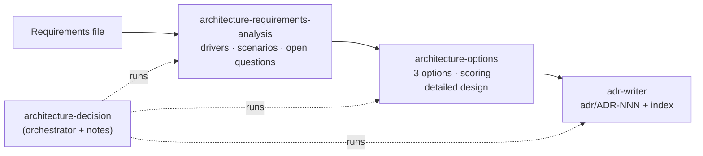

# Architecture Skills — Conversation Notes

| | |
|---|---|
| **Date** | 2026-10-27 |
| **Participants** | Michal Jaros (student) · Claude |
| **Topic** | Turning the NFFH architecture and ADR conversations into reusable Claude Code skills |
| **Inputs** | [NFFH_architecture_notes.md](NFFH_architecture_notes.md) · [NFFH_ADR_conversation_notes.md](NFFH_ADR_conversation_notes.md) · [adr/](adr/README.md) |
| **Output** | Four skills in [../.claude/skills/](../.claude/skills/) |

---

## 1. The request (verbatim)

> *"Hi, in previous conversations with you we have created an propositions of architectures for set requerments, we chose and architecutre and then created ADR for said architecture. The said conversations are in conversation notes @Week_05_Designing/NFFH_ADR_conversation_notes.md and @Week_05_Designing/NFFH_architecture_notes.md . What i want to do is to create Skill or a set of Skills for this type of task - that is proposing architectural solutions based on requirements, proposing different architectures, and finally choosing an architecture, creating an Architecture Decision Record (ADR). Create notes of this conversation also in some .md file"*

## 2. What was done

1. Read both conversation notes and the structure of the existing ADRs (`adr/README.md`, section headings of ADR-001 and ADR-004).
2. Extracted the workflow that the two conversations followed, and the lessons from their follow-ups.
3. Wrote four project-level skills in `.claude/skills/` (the repo root), so they are versioned with the labs and available in any Claude Code session opened in this repository.
4. Wrote these notes.

## 3. The skills

| Skill | Role | Main content |
|---|---|---|
| [architecture-decision](../.claude/skills/architecture-decision/SKILL.md) | **Orchestrator.** Entry point for "propose architectures and choose one". | Runs the three stages in order; when to stop for the user's choice; rules for conversation notes (verbatim request, follow-up log, corrections); quality bar. Template: [notes-template.md](../.claude/skills/architecture-decision/templates/notes-template.md). |
| [architecture-requirements-analysis](../.claude/skills/architecture-requirements-analysis/SKILL.md) | Stage 1 | Actors, capability groups with story numbers, missing NFRs as explicit assumptions, weighted drivers (1–5), quality-attribute scenarios, open questions Q1…. |
| [architecture-options](../.claude/skills/architecture-options/SKILL.md) | Stage 2 | N structurally different options with the same 7-part explanation each, side-by-side table, "hard parts" table, weighted scoring matrix, sensitivity check, draft ADR, detailed design of the winner. |
| [adr-writer](../.claude/skills/adr-writer/SKILL.md) | Stage 3 | `adr/ADR-NNN-*.md` + `adr/README.md` index, status rules, required sections, splitting into follow-up ADRs. Templates: [adr-template.md](../.claude/skills/adr-writer/templates/adr-template.md), [adr-index-template.md](../.claude/skills/adr-writer/templates/adr-index-template.md). |

## 4. Design decisions and why

| Choice | Why |
|---|---|
| **A set of skills, not one** | The previous work happened in separate conversations (selection, then ADRs), and the user sometimes wants only one stage. Each stage skill can be triggered alone; the orchestrator covers the full path. |
| **Project-level (`.claude/skills/`), not user-level** | The skills belong to this course repository and travel with it in git. They can be copied to `~/.claude/skills/` to use them everywhere. |
| **Structure taken from what worked** | Section order of the NFFH notes (§1 analysis → §2 options → §3 comparison → §4 draft ADR → §5 detailed design → §6 open questions) and the ADR section set from `adr/README.md`. |
| **Default spread of 3 options: modular monolith / microservices / serverless-BaaS** | They differ on the axes that matter for a typical web product (deployables, data ownership, who runs infra). The skill says to swap in other styles when the domain calls for it. |
| **Stop for the user's choice when the result is close** | Within 5 % or a sensitivity flip, the decision is the user's, not the model's. |
| **Templates as separate files** | Keeps `SKILL.md` short; templates are loaded only when writing. |

## 5. Lessons from the earlier conversations, built into the skills

| Lesson (source) | Where it is enforced |
|---|---|
| Requirements had no NFRs; they were inferred and labelled (architecture notes §1.4) | requirements-analysis §4, orchestrator quality bar |
| "Ignore Task_1…3" was respected and recorded | orchestrator "Before starting", requirements-analysis rules |
| User found "Decisions and consequences are too short" (ADR notes §7.1) | adr-writer content rules: numbered sub-decisions, consequence tables, impact on people, follow-up list, compliance table |
| Hot-products SQL had a `LEFT JOIN` filter that filtered nothing, mixed units, and broke module ownership (ADR notes §7.1, architecture notes §9.3) | "self-check every query/diagram against the architecture's own rules" in orchestrator, architecture-options §5 |
| Draft ADR in the notes was superseded by a full one | adr-writer status rules (`Supersedes` row) |
| Separate ADRs for stack, auth, cart/order, hot products | adr-writer "Splitting decisions" |
| User's follow-up "so you chose it for simplicity and team size?" showed the deciding reasons need to be stated clearly | architecture-options §4: say why the runner-up lost; one-sentence summary in notes |
| Corrections were added as visible notes, not silent edits | orchestrator notes rules, adr-writer "Corrections" |

## 6. How to use

* Full path: *"Act as an architect for `Tasks/data/<X>.txt`, propose 3 architectures, choose one and write the ADRs"* → `architecture-decision`.
* One stage: *"Analyse the requirements in …"*, *"Compare these architectures …"*, *"Write an ADR for …"* → the matching stage skill.
* Explicitly: type `/architecture-decision`, `/architecture-requirements-analysis`, `/architecture-options` or `/adr-writer`.
* Good test: run `/architecture-decision` on another file in `Tasks/data/` (e.g. `RecipeCove.txt`) and compare the output with the NFFH notes.

## 7. One-sentence summary

> The NFFH workflow (analyse requirements → propose and score three architectures → write ADRs, keeping notes throughout) is now four reusable skills: one orchestrator and one per stage, with the earlier follow-up lessons built in as rules.

---

*Append later follow-ups below.*

## 8. Follow-up log
