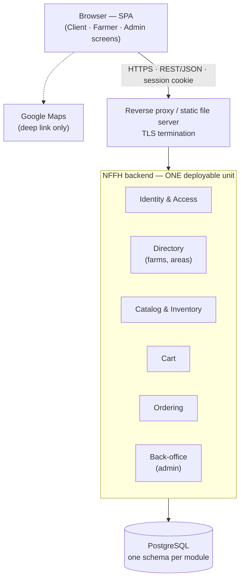
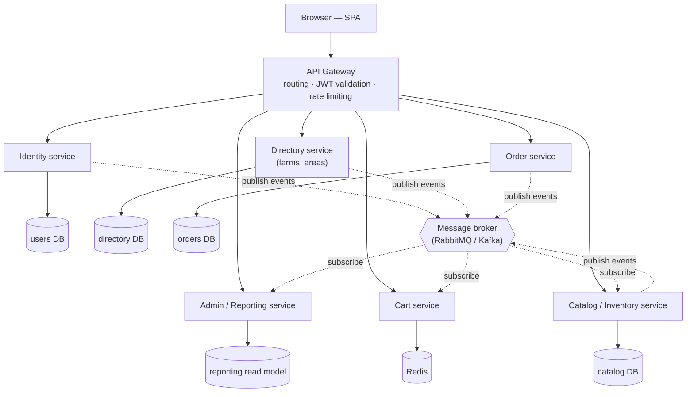
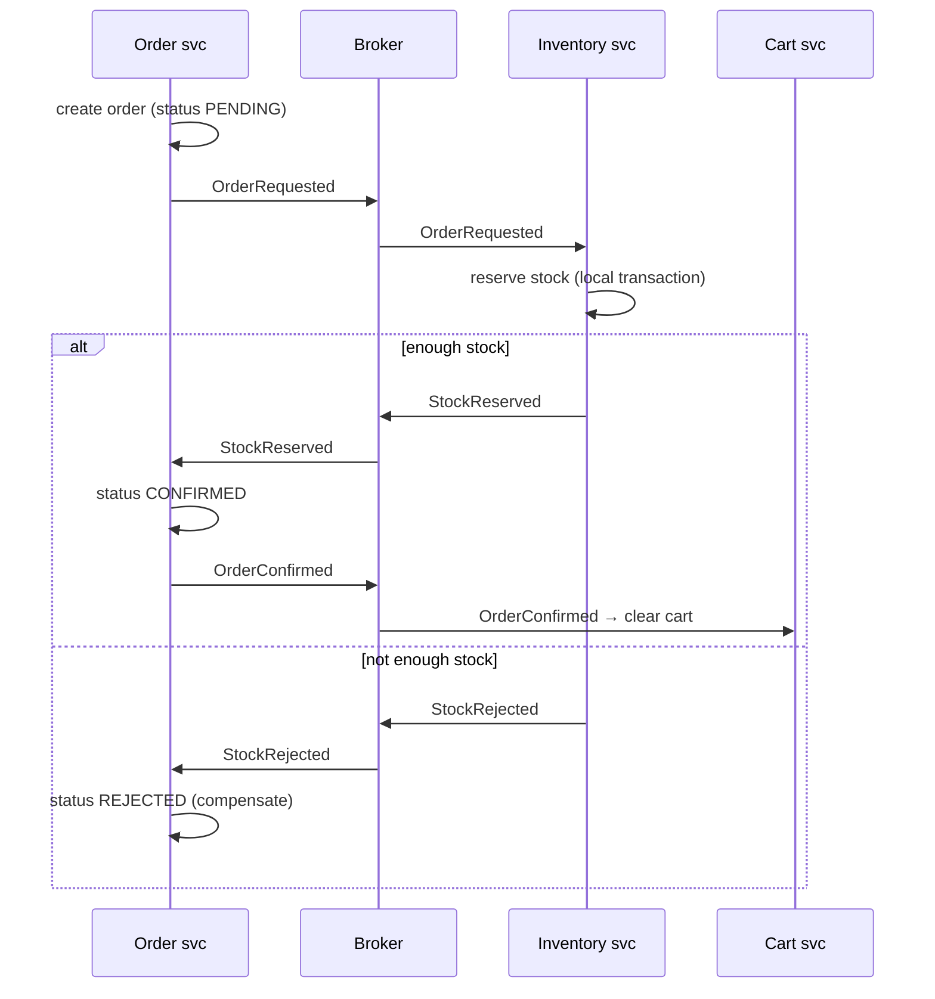
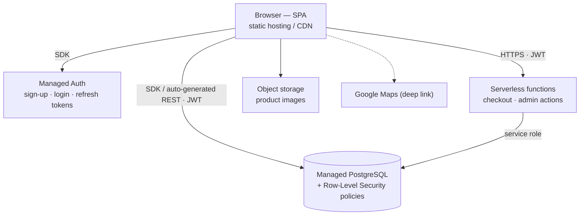
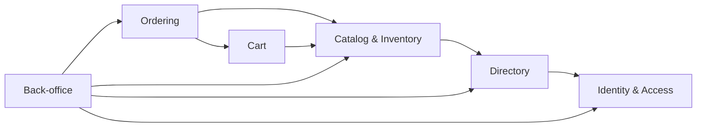
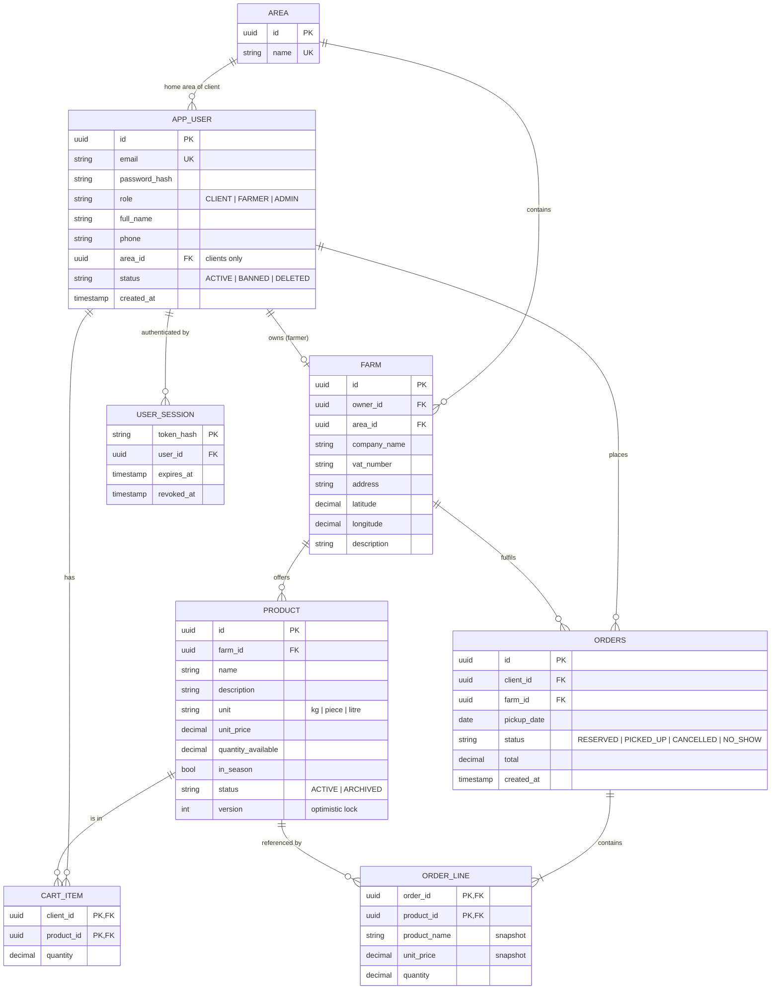
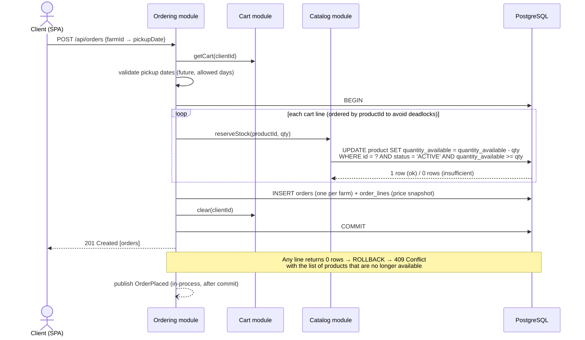
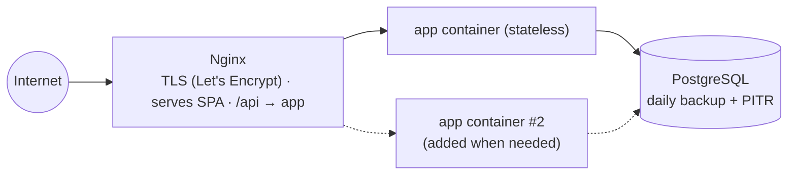

# NFFH — Architecture Selection Notes

| | |
|---|---|
| **Project** | **Not Far(m) From Home (NFFH)**: a "km 0" platform connecting local farms (Agricultural Companies) with consumers |
| **Requirements source** | [Tasks/data/NFFH.txt](Tasks/data/NFFH.txt): system description + 41 user stories |
| **Date** | 2026-10-27 |
| **Participants** | Michal Jaros (student) · Claude (acting as software-architecture consultant) |
| **Result** | **Modular monolith** (Option A) chosen. Weighted score **147 / 170**, against Serverless/BaaS **121** and Microservices **80** |

---

## 0. Conversation log

### 0.1 The request (verbatim)

> *"Hi, you are an software architecture expert that will help me choose an architecture for a software project for which the requerments are @Week_05_Designing/Tasks/data/NFFH.txt . Propose to me 3 different architecures, explain them to me fully, compare them and choose based on the requierments. Make detailed notes of this whole conversation into a new .md. Ignore the Task_1.md ... Task_3.md files"*

### 0.2 What was done, step by step

1. Read `Tasks/data/NFFH.txt` (system description and user stories 1–41).
2. Did **not** read `Task_1.md`, `Task_2.md` or `Task_3.md`, as instructed. The other data files (CDC, EFarmers, …) were not used either.
3. Analysed the requirements: actors, capabilities, what is missing, and the architectural drivers that follow from them ([§1](#1-requirements-analysis)).
4. Proposed three structurally different architectures and explained each one: idea, components, request flow, data, deployment, strengths and weaknesses ([§2](#2-the-three-candidate-architectures)).
5. Compared them qualitatively, then on the specific hard problems of NFFH, then with a weighted scoring matrix and a sensitivity check ([§3](#3-comparison)).
6. Recorded the decision as an Architecture Decision Record ([§4](#4-decision--adr-001)).
7. Worked out a detailed design of the chosen architecture ([§5](#5-detailed-design-of-the-chosen-architecture)).
8. Listed the open questions for the product owner and the next steps ([§6](#6-open-questions-for-the-product-owner), [§8](#8-next-steps)).

### 0.3 TL;DR

* NFFH is a **CRUD-heavy, regional web application with one genuinely transactional workflow**: reserving stock at checkout. Almost half of its stories (18 of 41) are **admin views across the whole dataset**.
* **Microservices** (Option B) solve problems NFFH doesn't have, such as independent scaling and many teams. They make the problems it *does* have harder: atomic stock reservation and cross-entity admin queries.
* **Serverless/BaaS** (Option C) is the fastest way to ship an MVP. The costs are vendor lock-in, business rules scattered across the client, the database policies and the functions, and weaker testability.
* A **modular monolith** (Option A) has one deployable unit and one PostgreSQL database, with code partitioned into business modules that have enforced boundaries. It matches the drivers best and still leaves a clean path to extract services later.

---

## 1. Requirements analysis

### 1.1 The system in one sentence

Farms publish their produce. Consumers browse the farms in their area, put products in a cart and **reserve** them, choosing a day to **pick them up at the farm**. An administrator maintains users, areas and products and monitors the platform.

> There is **no online payment and no delivery** in scope: the order is a reservation, and the money changes hands at pickup. This removes a lot of complexity (no PCI-DSS, no payment-provider integration, no logistics).

### 1.2 Actors

| Actor | Also called in the stories | Number of stories |
|---|---|---|
| **Client** (consumer) | "Client" | 14 (US 1–13, 40) |
| **Agricultural Company** (farm) | "Agricultural Company", "farmer" | 9 (US 14–21, 41) |
| **Administrator** | "Administrator of the site" | 18 (US 22–39) |
| *Google Maps* (external system) | — | used by US 13 |

### 1.3 User stories grouped by capability

| Capability | Stories | Notes for the architect |
|---|---|---|
| **Authentication & sessions** | 1, 2, 3, 4 · 17, 18, 19, 20 · 22, 23, 24 | 11 of 41 stories. "Don't make me re-enter credentials on reload" means a **persistent session**. Logout, plus admin deleting a malicious user, means sessions must be **revocable**. There is no story for admin registration, so admin accounts are seeded. |
| **Own profile** | 5, 21 | Read-only in the stories. Editing your own profile is not requested. |
| **Discovery** | 6 (hot products), 7 (farms in my area), 8 (products per farm), 13 (open in Google Maps) | "Hot products" is **undefined**: seasonal flag or popularity? "My area" is an admin-managed **Area** entity, not a GPS radius. |
| **Cart** | 9, 10, 11 | Needs a decision: server-side or browser-side cart? |
| **Ordering / reservation** | 12, 40, 41 | **The only workflow with real consistency risk.** Stock must not be oversold when two clients reserve the last units at the same time. A pickup date must be chosen. |
| **Farm inventory** | 14, 15, 16 | Farmers may touch **only their own** products. This needs object-level authorization. |
| **Admin: users** | 25, 27, 28, 29 | Delete or modify users. Deleting a user who has orders affects data integrity and GDPR. |
| **Admin: areas & farms** | 30, 31, 32, 35, 39 | "Farms grouped by area" is a reporting query. Deleting an area that still has farms is an integrity problem. |
| **Admin: products** | 33, 34, 36, 37, 38 | Same product CRUD as farmers, but across all farms. |
| **Admin: orders** | 26 | "See all orders" is a cross-entity reporting query. |

### 1.4 What the requirements do *not* say

The document lists **only functional user stories**. There are **no explicit non-functional requirements**: nothing about performance, availability, security level, data protection, budget, team size or deadline. An architecture is chosen mainly by quality attributes, so they had to be **inferred** from the nature of the system:

* **Scale**: "km 0", local farms, pickup in person. This is a **regional** platform with tens to hundreds of farms and thousands, not millions, of clients. Traffic is modest, with peaks before weekends.
* **Team and budget**: a university/startup-sized project, so a small team, a small budget and an interest in shipping quickly.
* **Criticality**: if the site is down for an hour nobody is harmed, because orders are reservations, not payments. Moderate availability is enough.
* **Security**: personal data (names, emails, phones, addresses) falls under GDPR in the EU. There are three roles with very different privileges.
* **Evolution**: online payment, notifications ("your order is ready"), pickup time slots, ratings and a mobile app are natural next features.

### 1.5 Architectural drivers (derived)

Weights run from 1 (nice to have) to 5 (critical). The same weights are used in the scoring matrix in [§3.3](#33-weighted-scoring-matrix).

| # | Driver | Weight | Why (traced to the requirements) |
|---|---|:-:|---|
| D1 | **Consistency of stock reservations** | 5 | US 12, 15, 16: a client must not reserve what the farm no longer has, and a race on the last units must not oversell. |
| D2 | **Cross-entity queries for admin** | 4 | US 26, 27, 31, 32, 33: all orders, all users, farms by area, products by seller. |
| D3 | **Development simplicity / time-to-market** | 5 | Small team, 41 mostly CRUD stories, nothing algorithmically hard. |
| D4 | **Operational cost & ops complexity** | 4 | A local platform with presumably a small budget and no dedicated ops team. |
| D5 | **Security: authN, revocable sessions, RBAC, ownership** | 4 | US 1–4, 17–20, 22–25. Three roles, and farmers must only touch their own data. |
| D6 | **Modifiability / evolvability** | 3 | Payments, notifications and similar features are likely next. |
| D7 | **Scalability** | 2 | Regional scale, low and predictable load. |
| D8 | **Availability / fault isolation** | 2 | Reservations, not payments, so moderate availability is fine. |
| D9 | **Testability** | 3 | The checkout logic and authorization rules must be testable automatically. |
| D10 | **Portability / vendor independence** | 2 | Avoid being locked into one provider for a small project's lifetime. |

### 1.6 Key quality-attribute scenarios

These make the drivers concrete and testable, in the ATAM style (source → stimulus → response → measure).

| Driver | Scenario |
|---|---|
| D1 | Two clients check out the **last 2 kg of tomatoes at the same moment**. **Exactly one** succeeds. The other gets a clear "insufficient quantity" message. Stock **never** goes negative. |
| D5 | A logged-in farmer sends `PATCH /products/{id}` for **another farm's** product. The server answers **403** and logs the attempt. |
| D5 | A client closes the browser and comes back within 30 days and is still logged in. After **logout**, or after the **admin deletes the account**, the very next request with the old session is rejected. |
| D2 | The admin opens "farms grouped by area" or "all orders this month" and the answer comes back in < 1 s without hand-written aggregation over several systems. |
| D6 | Adding "email the client when the farm marks the order ready" touches Ordering plus one new Notifications module, and **no other module**. |
| D7 | 200 concurrent users browsing farms in an area get a p95 response time < 500 ms on a single modest server. *(Assumed target.)* |

### 1.7 Working assumptions

* Web application first, usable on mobile browsers. A native app may come later, so the backend exposes a clean REST API.
* EU deployment, so GDPR applies.
* An Agricultural Company is represented by **one** user account (the "farmer").
* A client has one home **area**, chosen at registration. Farms belong to exactly one area.

---

## 2. The three candidate architectures

The three options differ along the axis that matters most for a project of this size: **how many deployable pieces there are, and who runs the infrastructure.**

| | A. Modular monolith | B. Microservices | C. Serverless / BaaS |
|---|---|---|---|
| Deployable units | 1 | 6+ | many small functions, plus managed services |
| Databases | 1 (schema per module) | 1 per service | 1 managed database |
| Who runs the infrastructure | you (simple) | you (complex) | the cloud provider |

---

### 2.1 Option A — Modular monolith (domain-partitioned, layered inside)

#### Idea

The whole backend is **one application**: one process, one deployment, one database. Its code is **not** organized by technical layer (`controllers/`, `services/`, `repositories/`) but by **business capability**, as modules that correspond to DDD bounded contexts. Each module:

* exposes a small **public interface** (a facade or service interface, plus events) that other modules may call;
* keeps everything else (entities, repositories, tables) **private**;
* is internally **layered**: API → application (use cases) → domain → infrastructure.

Modules talk by **in-process method calls**, or by **in-process domain events** for loose coupling. Module boundaries are **enforced by tooling in CI** (architecture tests), not left to discipline.

#### Diagram



#### Modules

| Module | Owns | Stories |
|---|---|---|
| **Identity & Access** | accounts, password hashes, roles, sessions, own profile | 1–5, 18–24 (+ account part of 17) |
| **Directory** | farm profiles (name, address, coordinates), areas | 7, 13, 17 (farm profile part) |
| **Catalog & Inventory** | products, prices, stock, "in season" flag, hot-products query | 6, 8, 14, 15, 16 |
| **Cart** | each client's cart lines | 9, 10, 11 |
| **Ordering** | orders, order lines, pickup dates, order status | 12, 40, 41 |
| **Back-office** | `/api/admin/**` endpoints and reporting queries; calls the other modules' public APIs | 25–39 |

#### How the critical request flows (checkout, US 12)

All modules run in one process against one database, so the whole checkout is **one local ACID transaction**. Either everything happens or nothing does. See [§5.6.3](#563-checkout-us-12--the-one-transactional-workflow) for the detailed sequence.

#### Data

There is one PostgreSQL instance. Each module owns its own tables, ideally in its **own Postgres schema** (`identity.*`, `catalog.*`, …). Other modules must not read those tables directly. The one pragmatic exception is **read-only reporting views** owned by Back-office for admin analytics.

#### Deployment

The backend runs as one container image. The SPA is served by Nginx or a CDN, and PostgreSQL is either managed or a container. Docker Compose on a single VM, or a PaaS, is enough. Scaling out means running *N* identical stateless instances behind a load balancer.

#### Strengths

* **Simplest thing that works**: one codebase, one build, one deploy, one log stream, one debugger session.
* **ACID transactions for free**, which solves D1 with a plain `UPDATE … WHERE qty >= n`.
* **Admin reporting is plain SQL joins**, which solves D2.
* **Cheap**: one small server (or PaaS tier) plus one database.
* **Easy end-to-end testing**: spin up the app plus a test database and call the API.
* **Module boundaries become seams for the future**: any module can be extracted into a service later (the "monolith first" approach).

#### Weaknesses

* The **whole application is redeployed** for every change. That's fine for one team, but painful for many teams.
* **One process means one failure domain**: a memory leak in one module takes the whole site down.
* Modules **can't be scaled independently**. Not needed at NFFH's scale.
* **Boundary erosion** is the classic failure mode: without enforcement, a modular monolith slowly turns into a "big ball of mud".
* One technology stack for everything.

#### Side note: why *modular* and not a plain layered monolith?

A **classic layered (n-tier) monolith** organizes code as `controllers/ → services/ → repositories/` for the *whole* system. It has the same runtime and deployment as Option A. The difference is in **how the code is cut**:

| | Plain layered monolith | Modular monolith |
|---|---|---|
| Top-level folders | technical layers | business modules |
| A new feature touches | every layer folder, mixed with unrelated features | mostly one module |
| Who can call whom | any service can call any repository | only through a module's public API |
| Path to microservices | hard: dependencies are tangled | each module is already a candidate service |

For a 41-story project both would work on day 1. The modular cut is almost free to adopt and pays off once features like payments and notifications arrive, so that is the variant proposed.

---

### 2.2 Option B — Microservices (API gateway + database per service + message broker)

#### Idea

Each business capability becomes an **independently deployable service** with its **own database**. Services communicate over the network: **synchronously** (REST/gRPC) for queries and **asynchronously** through a message broker (events such as `OrderPlaced` and `UserDeleted`). An **API gateway** is the single entry point. It handles routing, token validation and rate limiting. Each service has its own CI/CD pipeline and can be scaled, deployed and even written in a different language independently.

#### Diagram



#### Services

| Service | Owns | Notes |
|---|---|---|
| Identity | accounts, credentials, tokens | issues JWTs that the gateway validates |
| Directory | farms, areas | |
| Catalog / Inventory | products, stock | must react to `OrderRequested` to reserve stock |
| Cart | carts | typically a key-value store |
| Order | orders, pickup dates | runs the **checkout saga** |
| Admin / Reporting | denormalized read model of everything | built by consuming events from every other service (CQRS) |
| *(infra)* | gateway, broker, service discovery, centralized logging, distributed tracing, container orchestration (Kubernetes) | |

#### How the critical request flows (checkout): a saga

There is no shared database, so the order and the stock live in different services and **there is no single transaction**. The workflow becomes a **saga**: a chain of local transactions plus compensating actions.



The client therefore sees a **PENDING** order and must poll or receive a push to learn the result. Every step has to be **idempotent**, and the broker needs an **outbox pattern** so that events are not lost.

#### Strengths

* **Independent deployment and scaling** per service. If the catalog gets 100× the traffic of ordering, only the catalog gets scaled.
* **Fault isolation**: if the reporting service crashes, clients can still order.
* **Team autonomy**: separate teams can own separate services and choose their own technologies.
* Forces clean boundaries, because a network call is hard to cheat.

#### Weaknesses (for NFFH specifically)

* **Distributed-systems complexity**: network failures, retries, timeouts, idempotency, versioned APIs, eventual consistency.
* **D1 gets harder**: an atomic stock reservation becomes a saga with compensations and a "pending" UX.
* **D2 gets harder**: "all orders with client names grouped by farm area" spans three services. It needs either API composition (slow, fragile) or a separate CQRS read model fed by events (more code, eventual consistency).
* **Cross-cutting admin actions fan out**: "delete a malevolent user" (US 25) must propagate a `UserDeleted` event to every service.
* **Operational cost**: Kubernetes (or similar), a broker, tracing, many pipelines, many databases. That is roughly 6× the infrastructure for the same features.
* **Testing**: contract tests plus end-to-end tests across services, and an environment that is hard to run on a laptop.
* For a small team this is the textbook **"microservice premium"**: you pay the cost of distribution without having the scale or organization that justifies it.

---

### 2.3 Option C — Serverless / Backend-as-a-Service (BaaS)

#### Idea

You write **no long-running server**. The SPA talks **directly** to managed cloud building blocks:

* **Managed Auth** (e.g. Supabase Auth, Firebase Auth, AWS Cognito) for registration, login, persistent sessions and refresh tokens, all out of the box;
* a **managed database**, ideally PostgreSQL-based (Supabase, or Postgres plus a REST layer), where **Row-Level Security (RLS)** policies enforce who may read or write which rows;
* **serverless functions** (Edge Functions, AWS Lambda, Cloud Functions) for logic that must not run in the browser: checkout and privileged admin actions;
* **object storage** for product images.

You pay per use, the provider scales and patches everything, and at NFFH's scale it usually fits in a free or very cheap tier.

#### Diagram



#### How the stories map

* **Auth stories (11 of 41)** come almost for free from the managed Auth service.
* **Simple reads** (farms in area, products of a farm, my orders) are direct database queries from the SPA, protected by RLS, for example `farm.owner_id = auth.uid()` for farmer writes.
* **Checkout** runs in a **database function (RPC)** or a serverless function that executes one transaction: check stock, decrement it, insert the order and clear the cart.
* **Admin stories** run in functions using a privileged key, or through an `is_admin()` check in the RLS policies.

#### Strengths

* **Fastest time-to-market**: authentication, session persistence, the CRUD API, hosting and scaling are already built.
* **Near-zero operations**: no servers, OS patching or scaling configuration.
* **Very cheap at low traffic** (pay-per-use, often a free tier).
* **Automatic scalability** if the platform ever grows.
* With a **Postgres**-based BaaS, D1 (transactions) and D2 (SQL reporting) still work well.

#### Weaknesses

* **Vendor lock-in**: auth, RLS dialect, function runtime and SDK calls are all provider-specific, so migrating off means rewriting.
* **Business logic gets scattered** across the SPA, RLS policies, triggers and functions. It becomes harder to see and reason about "the rules of the system", which hurts D6.
* **Security by configuration**: one wrong or missing RLS policy exposes data directly to the browser. Misconfiguration is the most common BaaS incident.
* **Testability**: local emulation is partial and RLS policies are hard to unit-test, which hurts D9.
* **Cold starts and execution limits** on functions. Minor for NFFH.
* If a **NoSQL** BaaS (e.g. Firestore) were chosen instead, D2 would suffer: no joins, and queries like "farms grouped by area" or "all orders with client info" need denormalization.

---

### 2.4 Styles considered but not shortlisted

| Style | Why not a separate option |
|---|---|
| **Hexagonal / Clean architecture** | It organizes code *inside* a deployable, so it is complementary rather than an alternative. It can be used inside each module of Option A. |
| **Event-driven architecture (as the main style)** | NFFH is request/response by nature: browse, cart, reserve. Events help for future notifications, which Option A covers with in-process events. |
| **Server-side MVC with templates (e.g. Django/Rails views + HTMX)** | This is a *frontend* choice that fits inside Option A. It's valid, but a REST API plus SPA keeps the door open for a mobile app. |
| **CQRS / event sourcing** | Overkill. There is no audit or replay requirement, and the read/write ratio doesn't call for separate models. |

---

## 3. Comparison

### 3.1 Side-by-side

| Dimension | A. Modular monolith | B. Microservices | C. Serverless / BaaS |
|---|---|---|---|
| Deployable units | 1 | 6+ services plus infrastructure | functions plus managed services |
| Data consistency | ACID, one database | eventual, sagas | ACID inside a DB function or transaction |
| Cross-entity queries | SQL joins | API composition or a read model | SQL (if Postgres) |
| Dev complexity | low–medium | high | low at first, grows with rules |
| Ops complexity | low | very high | very low |
| Cost at NFFH scale | low (1 VM/PaaS + DB) | high (cluster, broker, many DBs) | very low (free/cheap tier) |
| Scalability ceiling | medium–high (stateless replicas) | very high | very high |
| Fault isolation | low (one process) | high | high (managed) |
| Testability | high | low–medium | low–medium |
| Modifiability | good (module seams) | good per service, costly across services | weak (logic scattered) |
| Vendor lock-in | none | low | high |
| Team size it suits | 1–8 devs | several teams | 1–3 devs |

### 3.2 How each option handles the hard parts of NFFH

| NFFH concern | A. Modular monolith | B. Microservices | C. Serverless / BaaS |
|---|---|---|---|
| **Persistent login + revocable logout** (US 3, 4, 19, 20, 23, 24) | server-side session in an HttpOnly cookie; delete the row to revoke | JWTs validated at the gateway; revocation needs a deny-list or short TTL plus refresh-token store | built into managed Auth |
| **Farmer edits only own products** (US 14–16) | ownership check in the Catalog application service | ownership check in the Catalog service, which needs farm ownership data from Directory (a call, or a replicated copy) | RLS policy `farm.owner_id = auth.uid()` |
| **Atomic stock reservation** (US 12) | one DB transaction (`UPDATE … WHERE qty >= n`) | saga across Order ⇄ Inventory with compensations and a "pending" UX | DB function (RPC) in one transaction |
| **Admin: all orders, farms by area** (US 26, 31) | SQL join or reporting view | read model fed by events from 3+ services | SQL view, secured for admin |
| **Admin deletes a malevolent user** (US 25) | one transaction: ban the user, revoke sessions, hide products | `UserDeleted` event that every service must handle | function: disable the auth user plus update rows |
| **Hot products** (US 6) | SQL aggregate over recent order lines, cached | Catalog needs order data from events, or Reporting computes it | SQL view or RPC |
| **Open farm in Google Maps** (US 13) | frontend deep link, same in every option | same | same |
| **Add online payments later** | new Payments module plus an Ordering change | new Payments service plus a saga step | functions plus a webhook handler; more scattered logic |

### 3.3 Weighted scoring matrix

The weights come from [§1.5](#15-architectural-drivers-derived). Scores run from 1 (poor) to 5 (excellent) for NFFH's context. Weighted = weight × score. The maximum possible is 34 × 5 = **170**.

| Driver | Weight | A score | A weighted | B score | B weighted | C score | C weighted |
|---|:-:|:-:|:-:|:-:|:-:|:-:|:-:|
| D1 Consistency of reservations | 5 | 5 | 25 | 2 | 10 | 4 | 20 |
| D2 Cross-entity admin queries | 4 | 5 | 20 | 2 | 8 | 4 | 16 |
| D3 Simplicity / time-to-market | 5 | 4 | 20 | 1 | 5 | 5 | 25 |
| D4 Ops cost & complexity | 4 | 5 | 20 | 1 | 4 | 4 | 16 |
| D5 Security (authN, RBAC, ownership) | 4 | 4 | 16 | 3 | 12 | 3 | 12 |
| D6 Modifiability / evolvability | 3 | 4 | 12 | 3 | 9 | 2 | 6 |
| D7 Scalability | 2 | 3 | 6 | 5 | 10 | 5 | 10 |
| D8 Availability / fault isolation | 2 | 3 | 6 | 4 | 8 | 4 | 8 |
| D9 Testability | 3 | 4 | 12 | 2 | 6 | 2 | 6 |
| D10 Portability / no lock-in | 2 | 5 | 10 | 4 | 8 | 1 | 2 |
| **Total** | **34** | | **147 (86 %)** | | **80 (47 %)** | | **121 (71 %)** |

**Rationale for the less obvious scores**

* **A on D3 = 4, not 5**: you still build authentication and the CRUD API yourself, while BaaS gives them to you.
* **C on D5 = 3**: managed Auth is strong, but authorization lives in RLS policies that are easy to get subtly wrong, and data is reachable directly from the browser.
* **B on D5 = 3**: centralized JWT validation is good, but every service-to-service call is extra attack surface, and revocation is harder.
* **B on D6 = 3**: a change *inside* a service is easy. A change *across* services (like adding pickup slots, which touches Directory, Catalog and Ordering) means coordinated releases and versioned contracts.

### 3.4 Sensitivity check: when would the answer change?

* **"We only care about shipping a demo in two weeks"**: double D3 to 10 and drop D10 to 0. A still scores 157 against C's 144, so A keeps the lead, but C becomes a reasonable choice for a throwaway prototype. Pick a **Postgres**-based BaaS to keep an exit path.
* **"National rollout, several dev teams, very uneven load per feature"**: D7, D8 and team autonomy would become high-weight drivers, D1 and D2 matter relatively less, and **B** starts to make sense. The recommended path is to *extract* services from A's modules when that happens, not to start with B.
* **"Strict data-residency, or no-cloud-provider policy"**: C is eliminated and A wins more clearly.

**Conclusion:** A wins under the inferred drivers and stays first under plausible re-weightings.

---

## 4. Decision — ADR-001

> **ADR-001: Use a modular monolith for NFFH**
>
> **Status:** Proposed (2026-10-27)
>
> **Context.** NFFH has 41 user stories across 3 roles. They are mostly CRUD, with one transactional workflow (reserving stock with a pickup date) and a large admin/reporting surface (18 stories). There are no explicit NFRs. The inferred context is regional scale, a small team, a small budget and likely future features (payments, notifications).
>
> **Decision.** Build NFFH as **one deployable backend application** partitioned into **six business modules** (Identity & Access, Directory, Catalog & Inventory, Cart, Ordering, Back-office). Each module has a public interface and private internals, and the boundaries are enforced by automated architecture tests. Use **one PostgreSQL database** with a schema per module. Expose a **REST/JSON API** consumed by a **single-page web application**. Use **server-side, revocable sessions** in HttpOnly cookies for authentication.
>
> **Alternatives considered.** (B) Microservices: rejected because distribution makes the two hardest requirements, atomic reservation and cross-entity admin queries, harder, and it multiplies operational cost without a scale or team need. (C) Serverless/BaaS: a strong runner-up for speed and cost, rejected because of vendor lock-in, business rules scattered across RLS, functions and the client, and weaker testability.
>
> **Consequences.**
> ✔ ACID checkout, SQL reporting, a single pipeline, low cost, easy testing.
> ✔ Module seams allow later extraction (e.g. Notifications, Payments) without a rewrite.
> ✘ The whole application is redeployed for every change, and there is a single failure domain. Mitigated by health checks, auto-restart and later by ≥2 stateless replicas.
> ✘ Boundaries can erode. Mitigated by architecture tests in CI and code-review rules.
>
> **Revisit when:** several independent teams work on the product, *or* one module needs a very different scaling or availability profile, *or* operating costs of the monolith exceed those of the extracted alternative.

---

## 5. Detailed design of the chosen architecture

### 5.1 Module catalogue and story mapping

| Module | Public interface (examples) | Client stories | Farmer stories | Admin stories (via Back-office) |
|---|---|---|---|---|
| **Identity & Access** | `register`, `login`, `logout`, `currentUser`, `getProfile`, `banUser`, `updateUser` | 1, 2, 3, 4, 5 | 17 (account), 18, 19, 20, 21 | 22, 23, 24, 25, 27, 28, 29 |
| **Directory** | `registerFarm`, `farmsInArea`, `getFarm`, `listAreas`, `addArea`, `deleteArea` | 7, 13 | 17 (farm profile) | 30, 31, 32, 35, 39 |
| **Catalog & Inventory** | `productsOfFarm`, `hotProducts`, `addProduct`, `updateProduct`, `archiveProduct`, `reserveStock`, `releaseStock` | 6, 8 | 14, 15, 16 | 33, 34, 36, 37, 38 |
| **Cart** | `addItem`, `removeItem`, `getCart`, `clear` | 9, 10, 11 | — | — |
| **Ordering** | `checkout`, `ordersOfClient`, `ordersOfFarm`, `allOrders` | 12, 40 | 41 | 26 |
| **Back-office** | `/api/admin/**` controllers and reporting views | — | — | 25–39 (composes the above) |

All 41 stories are covered.

### 5.2 Module dependency rules



* Dependencies point in **one direction only**, with **no cycles**. A test fails the build if a cycle appears.
* A module may use another module **only through its public interface** (`<module>/api` package). Never through its repositories or tables.
* Shared kernel (`shared/`): security context (`CurrentUser`), error handling, money and quantity types, the in-process event bus. Keep it **small**.
* "Upward" notifications, such as Ordering telling a future Notifications module that an order was placed, go through **in-process domain events** (`OrderPlaced`, `UserBanned`, `ProductArchived`). That avoids reverse dependencies.

### 5.3 Code structure (stack-neutral)

```
nffh/
├── frontend/                     # SPA (Client, Farmer and Admin screens; role-based routing)
└── backend/
    └── src/
        ├── shared/               # security context, errors, event bus, common types
        ├── identity/
        │   ├── api/              # public facade + DTOs (the ONLY thing others may import)
        │   ├── web/              # REST controllers: /api/auth/**, /api/me
        │   ├── application/      # use cases: RegisterUser, Login, Logout, ...
        │   ├── domain/           # User, Role, Session, rules
        │   └── infrastructure/   # repositories, password hasher
        ├── directory/            # same internal layout
        ├── catalog/
        ├── cart/
        ├── ordering/
        └── backoffice/           # /api/admin/** + reporting queries
```

### 5.4 Data model



Design notes:

* **One order per farm.** Pickup happens *at the farm*, so a cart holding products from three farms becomes **three orders** at checkout, each with its own pickup date. *(Open question Q1: alternatively, restrict a cart to one farm.)*
* **Price and name snapshot** in `ORDER_LINE`. Later edits by the farmer (US 16) or deletion (US 15/38) must not rewrite order history.
* **Soft delete** for products (`ARCHIVED`) and users (`BANNED`/`DELETED`) that are referenced by orders. Hard delete would break referential integrity.
* `quantity_available` is decremented **at checkout**, so the cart does not hold stock, and restored on `CANCELLED`.
* `USER_SESSION` stores only a **hash** of the session token. A database leak then doesn't leak live sessions.

### 5.5 REST API sketch

| Method & path | Role | Story |
|---|---|---|
| `POST /api/auth/register` (body: `role = CLIENT \| FARMER`, profile, farm data if farmer) | public | 1, 17 |
| `POST /api/auth/login` (body: `rememberMe`) | public | 2, 18, 22 |
| `POST /api/auth/logout` | any | 4, 20, 24 |
| `GET /api/me` | any | 3, 5, 19, 21, 23 |
| `GET /api/products/hot` | client | 6 |
| `GET /api/areas` | any | 7, 30 |
| `GET /api/farms?areaId=` | client | 7 |
| `GET /api/farms/{id}` (incl. `mapsUrl`) | client | 13 |
| `GET /api/farms/{id}/products` | client | 8 |
| `GET /api/cart` · `POST /api/cart/items` · `DELETE /api/cart/items/{productId}` | client | 11 · 9 · 10 |
| `POST /api/orders` (body: pickup date per farm) | client | 12 |
| `GET /api/orders/mine` | client | 40 |
| `GET /api/farm/orders` | farmer | 41 |
| `POST /api/farm/products` · `PATCH /api/farm/products/{id}` · `DELETE /api/farm/products/{id}` | farmer (owner) | 14 · 16 · 15 |
| `GET /api/admin/users` · `GET /api/admin/users/{id}` · `PATCH /api/admin/users/{id}` · `DELETE /api/admin/users/{id}` | admin | 27 · 28 · 29 · 25 |
| `GET /api/admin/orders` | admin | 26 |
| `POST /api/admin/areas` · `DELETE /api/admin/areas/{id}` | admin | 35 · 39 |
| `GET /api/admin/farms?groupBy=area` · `GET /api/admin/farms/{id}` | admin | 31 · 32 |
| `GET /api/admin/products?sellerId=` · `GET /api/admin/products/{id}` | admin | 33 · 34 |
| `POST /api/admin/products` · `PATCH /api/admin/products/{id}` · `DELETE /api/admin/products/{id}` | admin | 36 · 37 · 38 |

### 5.6 Key mechanisms

#### 5.6.1 Authentication and persistent sessions (US 1–4, 17–20, 22–24)

* Passwords are hashed with **Argon2id** (or bcrypt). Login is rate-limited and returns a generic "invalid credentials" error.
* On login the server creates a random session token, stores its **hash** in `USER_SESSION`, and sets it as a cookie: `HttpOnly; Secure; SameSite=Lax`.
  * `rememberMe = true` → 30-day sliding expiry, so the user isn't asked for credentials on reload (US 3, 19, 23).
  * otherwise → a session cookie with a short idle timeout.
* **Logout** (US 4, 20, 24) sets `revoked_at`. The next request with that cookie gets a 401.
* **Why not pure stateless JWT?** A stateless JWT can't be revoked before it expires. That conflicts with logout and with the admin "delete malevolent user" story (US 25), which must kick the user out **immediately**. Server-side sessions are simpler and correct here. *(An acceptable alternative is a 15-minute JWT plus a rotating refresh token stored hashed in the database.)*
* Cookies need **CSRF protection**: SameSite plus a CSRF token on state-changing requests.
* **Admin accounts** are created by a seed or migration script, since there is no admin registration story.

#### 5.6.2 Authorization: role plus ownership

* **Role check** at the endpoint: `/api/farm/**` requires FARMER, `/api/admin/**` requires ADMIN, and cart and order endpoints require CLIENT.
* **Ownership check** in the application service: before `updateProduct(id)`, verify that `product.farm.owner_id == currentUser.id`. Otherwise return **403**. This prevents IDOR, which falls under OWASP Top 10 "Broken Access Control", the #1 web risk.
* Clients see only their own orders, and farmers only orders for their farm, by filtering on the current user's id and never on an id taken from the request.

#### 5.6.3 Checkout (US 12): the one transactional workflow



* The **conditional `UPDATE … WHERE quantity_available >= qty`** is atomic in PostgreSQL. Two concurrent checkouts can't both succeed for the last units, which satisfies scenario D1.
* The transaction spans three modules. That is acceptable **inside** a monolith, because they share one transaction manager. If Catalog were ever extracted as a service, this would be the place to introduce a saga.

#### 5.6.4 Hot products (US 6)

"Hot" isn't defined in the requirements (see Q3). The proposed default combines two signals:

1. **Popularity**: the products with the highest reserved quantity in the last 14 days, among farms in the client's area.
2. **Seasonality**: an `in_season` flag set by the farmer. This is the cold-start fallback when there are no orders yet.

```sql
SELECT p.id, p.name, p.unit_price, f.company_name, SUM(ol.quantity) AS reserved_14d
FROM catalog.product p
JOIN directory.farm f       ON f.id = p.farm_id
LEFT JOIN ordering.order_line ol ON ol.product_id = p.id
LEFT JOIN ordering.orders o ON o.id = ol.order_id AND o.created_at >= now() - interval '14 days'
WHERE f.area_id = :clientAreaId
  AND p.status = 'ACTIVE' AND p.quantity_available > 0
GROUP BY p.id, f.company_name
ORDER BY reserved_14d DESC NULLS LAST, p.in_season DESC
LIMIT 12;
```

This crosses module schemas, so it is implemented as a **read-only view owned by Catalog** and cached for a few minutes.

#### 5.6.5 Areas and Google Maps (US 7, 13, 30, 35, 39)

* An **area** is an admin-managed lookup entity. "Farms in my area" is `WHERE farm.area_id = client.area_id`, with no geospatial engine needed.
* **Google Maps** needs **no API key and no backend integration**. Store the farm's address plus latitude and longitude, and the frontend opens
  `https://www.google.com/maps/search/?api=1&query=<lat>,<lng>`.
  The external dependency stays at the very edge of the system: if Google changes something, only one URL template changes.
* **Deleting an area** (US 39) that still has farms or clients is refused with `409 Conflict` ("reassign first"), so nothing is orphaned.

#### 5.6.6 Admin deletes a malevolent user (US 25)

In one transaction:

1. set `status = BANNED`;
2. revoke all their sessions;
3. if the user is a farmer, archive their products and cancel future `RESERVED` orders, restoring stock;
4. keep past orders, which are needed for integrity and statistics.

Then publish `UserBanned` (a future Notifications module could email affected clients). Personal data can be **anonymized** on request, to meet GDPR's right to erasure (see Q6).

### 5.7 Example technology stacks

The architecture is stack-neutral. Any of these implements it well:

| Concern | Java | TypeScript | Python |
|---|---|---|---|
| Backend framework | Spring Boot | NestJS | Django + Django REST Framework |
| Module boundary enforcement | **Spring Modulith** / ArchUnit | dependency-cruiser / eslint-plugin-boundaries | import-linter |
| Persistence & migrations | JPA + Flyway | Prisma or TypeORM | Django ORM + migrations |
| Sessions & auth | Spring Security (sessions in DB) | Passport + session store | Django auth (DB sessions) |
| Frontend | React / Vue / Angular SPA | same | same, or Django templates + HTMX |
| Database | PostgreSQL | PostgreSQL | PostgreSQL |

### 5.8 Deployment and operations



* **Environments**: local (Docker Compose), staging, production.
* **CI pipeline**: lint, unit tests, **architecture (module boundary) tests**, integration tests against real Postgres (Testcontainers), container image build, deploy.
* **Observability**: structured JSON logs, a `/health` endpoint, basic metrics (request rate, latency, errors), an external uptime monitor.
* **Security hygiene**: HTTPS only, secrets in environment or vault, dependency vulnerability scanning, OWASP ASVS level 1 as the checklist.

### 5.9 Evolution path

| When | Step |
|---|---|
| Launch | 1 app instance, 1 Postgres |
| More traffic | vertical scaling, then ≥2 stateless replicas behind Nginx (sessions are already in the DB) |
| Heavy admin analytics | Postgres read replica for Back-office queries |
| New features (payments, notifications, pickup slots, ratings) | new **modules** that subscribe to in-process events (`OrderPlaced`, `UserBanned`) |
| One module needs independent scaling or a separate team | **extract** that module into a service (strangler-fig pattern); its public interface becomes its network API, and its schema becomes its own DB |
| Mobile app | reuses the same REST API |

### 5.10 Risks and mitigations

| Risk | Mitigation |
|---|---|
| Module boundaries erode over time | automated architecture tests in CI; "public API only" rule in code review |
| Shared database becomes a hidden coupling point | schema per module; no cross-module joins except read-only views owned by one module |
| Single process is a single point of failure | container auto-restart, health checks, 2 replicas once it matters, tested backups |
| Deadlocks or long locks at checkout | short transactions; lock rows in a consistent order (by product id); conditional `UPDATE` instead of `SELECT … FOR UPDATE` where possible |
| Broken access control (IDOR) | ownership checks in application services, plus tests that try to access other users' resources |
| Ambiguous requirements cause rework | resolve the open questions in §6 before implementing the affected modules |

---

## 6. Open questions for the product owner

| # | Question | Affects | Proposed default |
|---|---|---|---|
| Q1 | Can a cart contain products from **several farms**? | Cart, Ordering | Yes; checkout splits into **one order per farm**, each with its own pickup date |
| Q2 | Which **pickup dates** are allowed? (any future day? farm opening days? time slots? max days ahead?) | Directory, Ordering | Any date from tomorrow up to 14 days ahead; add farm opening days later |
| Q3 | What exactly are **"hot products"**? | Catalog | Popular in the last 14 days in the client's area, plus the farmer's `in_season` flag |
| Q4 | What is the **order lifecycle**? Can a client cancel? Can a farmer mark "picked up" or "no-show"? (US 41 only says "see") | Ordering | `RESERVED → PICKED_UP / CANCELLED / NO_SHOW`; client can cancel until the day before |
| Q5 | Does a newly registered **farm need admin approval** before it is visible? | Directory, Back-office | No (the stories only mention deleting malevolent users after the fact) |
| Q6 | On **user deletion**, must personal data be erased (GDPR) while order history is kept? | Identity, Ordering | Soft delete plus anonymization of PII on request |
| Q7 | Are **product images** needed? | Catalog, infrastructure | Yes, one image per product in object storage |
| Q8 | Should users get **notifications** (email/SMS) for orders? | future Notifications module | Not in v1; the design allows adding them |
| Q9 | Which **languages** must the UI support? (the source text suggests an Italian origin) | Frontend | i18n-ready UI, Italian and English |
| Q10 | Explicit **NFR targets**: users, response time, uptime, budget? | all | The assumptions in §1.4 and §1.6 |

---

## 7. Glossary

| Term | Meaning |
|---|---|
| **km 0** | Food sold close to where it is produced, with minimal transport |
| **Monolith** | An application built and deployed as a single unit |
| **Modular monolith** | A monolith whose code is split into business modules with explicit, enforced interfaces |
| **Microservices** | An architecture of small, independently deployable services, each owning its data |
| **BaaS** | Backend-as-a-Service: managed auth, database, storage and functions used directly from the frontend |
| **Bounded context** | A DDD term for a part of the domain with its own consistent model and language; here, one module |
| **ACID** | Atomicity, Consistency, Isolation, Durability: the guarantees of a database transaction |
| **Saga** | A sequence of local transactions with compensating actions, used instead of a distributed transaction |
| **CQRS** | Command Query Responsibility Segregation: separate models for writes and reads |
| **RLS** | Row-Level Security: database policies that decide which rows a user may read or write |
| **IDOR** | Insecure Direct Object Reference: accessing another user's object by changing an id |
| **ADR** | Architecture Decision Record: a short document recording a decision, its context and its consequences |
| **ATAM** | Architecture Tradeoff Analysis Method, a scenario-based evaluation of architectures against quality attributes |
| **Strangler-fig pattern** | Gradually replacing or extracting parts of a system behind a stable interface |

---

## 8. Next steps

1. Get answers to the open questions **Q1–Q4** first, since they change the Ordering and Catalog design.
2. Choose the concrete tech stack (§5.7) according to the team's experience.
3. Produce the remaining design artefacts: a C4 container and component diagram, the final ER model, and an OpenAPI spec from §5.5.
4. Set up the skeleton: module folders, architecture tests, CI, Docker Compose, the database migration for §5.4.
5. Implement in vertical slices: Identity, then Directory, Catalog, Cart, Ordering and finally Back-office.

---

*These notes record the whole conversation of 2026-10-27. Later follow-up questions and answers should be appended below.*

## 9. Follow-up log

### 9.1 "So you chose the one-deployable monolith due to its simplicity and no need for multiple teams?"

**Answer: partly right.** Both are real reasons, but they are not the main ones, and "monolith" alone misses an important part of the decision.

**What the summary gets right**

* Simplicity (D3, weight 5) and low operating cost (D4) are big advantages of Option A.
* One small team means the main benefit of microservices, independent teams deploying independently, brings nothing here.

**What should be added**

1. **The deciding reasons are in the requirements, not only in team size.**
   * **Atomic stock reservation (US 12, D1, weight 5).** In one database, completing an order is a single transaction, so two clients can never both reserve the last units. With microservices this becomes a saga with undo steps and a "pending" order.
   * **Admin reports across all data (US 25–39, D2, weight 4).** 18 of 41 stories are admin stories. In one database they are SQL joins. With microservices they need a separate read model built from events.
   * Even a large team would not change this: these two requirements favour one database regardless of who builds the system.
2. **It is a *modular* monolith, not just a monolith.** The code is split into six business modules with public interfaces, and automated architecture tests stop modules from reaching into each other. Without that, a monolith tends to become a "big ball of mud".
3. **Scale fits a single deployable.** NFFH is a regional "km 0" platform with modest, predictable traffic. One server handles it, and stateless replicas can be added later. Microservices' independent scaling solves a problem NFFH does not have.
4. **Testability and security are easier.** One application can be tested end to end against a real database. Sessions live in the database, so logout and an admin ban take effect immediately.
5. **It is not a one-way door.** The module boundaries are the seams along which a module can later be extracted into a service ("monolith first", strangler-fig pattern), for example Notifications or Payments.
6. **Serverless was the close runner-up, not microservices.** It scored 121 against A's 147. It lost because of vendor lock-in, business rules spread across the browser, database rules and functions, and weaker testability. It did not lose on simplicity.
7. **The known costs are accepted on purpose.** Every change redeploys the whole application, and one process is one failure domain. These are mitigated by health checks, automatic restart and later a second replica (see ADR-001 consequences).

**Better one-sentence summary:**
> We chose a **modular monolith** because NFFH's hardest requirements, atomic stock reservation and cross-data admin reports, are trivial with one transactional database. It is also the cheapest and simplest option at a regional scale with a small team, and its module boundaries keep the option to extract services later.

### 9.2 "Create an ADR for the modular monolith"

The draft ADR in [§4](#4-decision--adr-001) was expanded into a full, standalone record with status **Accepted**: [adr/ADR-001-modular-monolith.md](adr/ADR-001-modular-monolith.md). It supersedes the §4 draft. Notes from that conversation: [NFFH_ADR_conversation_notes.md](NFFH_ADR_conversation_notes.md).

### 9.3 ADR-001 expanded; ADR-002 to ADR-005 written

All decisions are now in [adr/](adr/README.md): ADR-001 modular monolith (expanded), ADR-002 technology stack, ADR-003 authentication, ADR-004 cart and order per farm, ADR-005 hot products. Details: [NFFH_ADR_conversation_notes.md §7.1](NFFH_ADR_conversation_notes.md#71-decisions-and-consequences-are-too-short-write-also-adr-002-to-adr-005).

> **Correction to §5.6.4:** the hot-products query there is wrong. The 14-day filter is on the `LEFT JOIN` to `orders` and filters nothing, it sums quantities across different units, and it reads Ordering's tables from Catalog. Use [ADR-005](adr/ADR-005-hot-products.md) instead.
