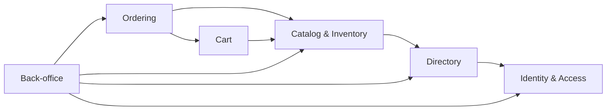

# ADR-001: Build NFFH as a modular monolith

| | |
|---|---|
| **Status** | Accepted |
| **Date** | 2026-10-27 |
| **Deciders** | Michal Jaros (student), with Claude as architecture consultant |
| **System** | Not Far(m) From Home (NFFH), a "km 0" platform connecting local farms with consumers |
| **Requirements** | [../Tasks/data/NFFH.txt](../Tasks/data/NFFH.txt): system description and 41 user stories |
| **Analysis** | [../NFFH_architecture_notes.md](../NFFH_architecture_notes.md): requirements analysis, three candidate architectures, scoring |
| **Supersedes** | The draft ADR in §4 of the architecture notes (status "Proposed") |
| **Related** | [ADR-002](ADR-002-technology-stack.md) stack · [ADR-003](ADR-003-authentication-sessions.md) authentication · [ADR-004](ADR-004-cart-and-order-per-farm.md) cart and checkout · [ADR-005](ADR-005-hot-products.md) hot products |

---

## 1. Context

### 1.1 What the system does

Farms (Agricultural Companies) publish their produce. Clients browse the farms in their area, add products to a cart and **reserve** them, choosing a day to **pick them up at the farm**. An Administrator maintains users, areas and products and monitors the platform.

There is **no online payment and no delivery**. An order is a reservation; money changes hands at pickup.

### 1.2 What the requirements contain

| Group | Stories | Count |
|---|---|:-:|
| Authentication and persistent, revocable sessions (all three roles) | 1–4, 17–20, 22–24 | 11 |
| Own profile | 5, 21 | 2 |
| Discovery: hot products, farms in my area, products per farm, Google Maps link | 6, 7, 8, 13 | 4 |
| Cart | 9, 10, 11 | 3 |
| Ordering: checkout with pickup date, my orders, farm's orders | 12, 40, 41 | 3 |
| Farm inventory (own products only) | 14, 15, 16 | 3 |
| Administration: users, areas, farms, products, all orders | 25–39 | 15 |

The stories are almost entirely CRUD. Two things are harder than CRUD:

1. **Checkout (US 12) must reserve stock atomically.** Two clients ordering the last units at the same time must not both succeed, and stock must never go negative.
2. **Admin stories need queries across all data** (US 26, 27, 31, 32, 33): all orders, all users, farms grouped by area, products by seller.

### 1.3 What the requirements do not contain

There are **no explicit non-functional requirements**. The following were inferred and are the basis of this decision (see notes §1.4):

* **Scale:** regional. Tens to hundreds of farms, thousands of clients, modest and predictable traffic.
* **Team and budget:** small team, small budget, priority on shipping.
* **Criticality:** moderate. An outage delays reservations; no money is lost.
* **Security and privacy:** personal data under GDPR; three roles with very different rights; farmers may change only their own products.
* **Evolution:** payments, notifications, pickup slots, ratings and a mobile app are likely next features.

### 1.4 Decision drivers

| # | Driver | Weight (1–5) |
|---|---|:-:|
| D1 | Consistency of stock reservations | 5 |
| D2 | Cross-entity queries for admin | 4 |
| D3 | Development simplicity / time-to-market | 5 |
| D4 | Operational cost and complexity | 4 |
| D5 | Security: authentication, revocable sessions, roles, ownership | 4 |
| D6 | Modifiability / evolvability | 3 |
| D7 | Scalability | 2 |
| D8 | Availability / fault isolation | 2 |
| D9 | Testability | 3 |
| D10 | Portability / no vendor lock-in | 2 |

---

## 2. Decision

**NFFH is built as one deployable backend application, partitioned internally into business modules with enforced boundaries, backed by one PostgreSQL database.**

The sections below make that sentence concrete enough to build and to check.

### 2.1 Deployment unit and runtime

* The backend is **one container image** (`nffh-backend`) containing all modules. There is one build, one version number and one deploy pipeline.
* The single-page web app is built to static files and served by **Nginx** (or a CDN). Nginx also terminates TLS and forwards `/api/**` to the backend.
* The backend is **stateless**: nothing needed for correctness lives in process memory. Sessions are in the database ([ADR-003](ADR-003-authentication-sessions.md)), carts are in the database ([ADR-004](ADR-004-cart-and-order-per-farm.md)). The only in-memory state is a short-lived cache (e.g. hot products, [ADR-005](ADR-005-hot-products.md)), where stale data is harmless. So any replica can serve any request.
* **Start with one instance and one PostgreSQL.** Add a second identical replica behind Nginx when uptime starts to matter. No other change is needed to do that.

*Why:* one unit is the cheapest to build, run and debug (D3, D4). Statelessness keeps horizontal scaling available for later (D7) without paying for it now.

### 2.2 The six modules

Code is split by **business capability**, not by technical layer. Each module corresponds to a bounded context.

| Module | Responsible for | Not responsible for | Stories |
|---|---|---|---|
| **Identity & Access** | accounts, password hashes, roles, sessions, login/logout, own profile, user status (active, banned, deleted) | farm data, orders | 1–5, 17 (account), 18–24 |
| **Directory** | areas; farm profiles (company name, VAT number, address, coordinates, owner); "farms in area"; Google Maps link | products, stock | 7, 13, 17 (farm profile) |
| **Catalog & Inventory** | products, prices, units, stock, in-season flag, product status; reserving and releasing stock; hot products | carts, orders | 6, 8, 14–16 |
| **Cart** | each client's cart lines | stock (a cart does **not** reserve anything) | 9–11 |
| **Ordering** | checkout, orders, order lines with price snapshots, pickup dates, order status, "my orders", "farm's orders" | product master data | 12, 40, 41 |
| **Back-office** | the `/api/admin/**` endpoints and the admin reporting views | its own business data; it has none | 25–39 |

**Back-office owns no business tables.** Every admin *write* goes through the public interface of the module that owns the data. So an admin deleting a product archives it through Catalog, under exactly the same rules as a farmer doing it. Admin *reads* that span modules (all orders with client and farm names, farms grouped by area) use read-only reporting views that Back-office owns.

A farmer's registration (US 17) touches two modules: Identity creates the account, then Directory creates the farm profile, in one transaction.

### 2.3 Inside a module

Every module has the same internal layout:

```
<module>/
├── api/             public interface and DTOs; the ONLY package other modules may import
├── web/             REST controllers for this module's endpoints
├── application/     use cases (one class or method per story-level action), transactions, authorization checks
├── domain/          entities, value objects, business rules; no framework or database code
└── infrastructure/  repositories, SQL, external adapters
```

Calls go **downwards only**: `web → application → domain`, and `application → infrastructure` through interfaces defined in `application` or `domain`. Controllers never call repositories directly. Business rules live in `domain` and `application`, never in controllers or SQL triggers, so they can be unit-tested without a database.

### 2.4 How modules depend on each other



Rules:

1. A module may use another module **only through its `api` package**. Importing another module's `domain`, `application` or `infrastructure` code is forbidden.
2. Dependencies follow the arrows above. **No cycles.** A new arrow requires updating this diagram in review.
3. **Synchronous in-process calls** are used when the caller needs an answer, or needs the work done inside its own transaction. Example: Ordering calls `Catalog.reserveStock()` during checkout.
4. **In-process domain events** are used when a lower module must cause a reaction in a higher one, which a direct call would turn into a cycle. Example: Identity publishes `UserBanned`; Directory, Catalog and Ordering react to it.
5. Events come in two kinds:

   | Kind | Runs | Used for | Examples |
   |---|---|---|---|
   | **Business reaction** | synchronously, **inside** the publisher's transaction; if a listener fails, everything rolls back | reactions that are part of the business rule and must be atomic with it | `UserBanned` → archive the farm's products, cancel its future reservations, restore stock |
   | **Side effect** | **after commit**, recorded in an outbox table so it is not lost on a crash | things that may happen a little later or be retried | `OrderPlaced` → update popularity counts ([ADR-005](ADR-005-hot-products.md)); future e-mail notifications |

6. A small **shared kernel** (`shared/`) holds only cross-cutting basics: the current-user security context, the error model, money and quantity types, the event bus. Business logic does not go there.

### 2.5 Data

* **One PostgreSQL database** with **one schema per module**: `identity`, `directory`, `catalog`, `cart`, `ordering`, plus `backoffice` for its reporting views only.
* **Each module owns its schema.** Only that module's `infrastructure` code reads or writes it. Each module keeps its own migration scripts in its own folder, and a single migration tool applies them all in order.
* **Cross-schema foreign keys are allowed, but only in the direction of the module dependencies** (e.g. `ordering.order_line.product_id → catalog.product.id`, `directory.farm.owner_id → identity.app_user.id`). They protect integrity, which matters more today than ease of extracting a module later. Each one is listed in the module's README as a known extraction cost.
* **Cross-schema reads** are allowed only in read-only views owned by Back-office, for admin reporting. Business modules never join into another module's tables.
* **Records that orders refer to are never hard-deleted.** Products are archived; users are banned or anonymized. Order lines keep a snapshot of product name and unit price, so later edits never rewrite history.
* Conventions: UUID primary keys; money as `numeric(10,2)`; quantities as `numeric(10,3)` with an explicit unit (`kg`, `piece`, `litre`); timestamps in UTC (`timestamptz`); dates for pickup (`date`, farm local time).

The full data model is in notes §5.4.

### 2.6 Checkout as one local transaction

Checkout (US 12) is the one workflow where correctness under concurrency matters. It runs as **one ACID transaction** that spans Ordering, Cart and Catalog:

1. Ordering loads the client's cart through `Cart.getCart()`.
2. Ordering validates the requested pickup date for each farm ([ADR-004](ADR-004-cart-and-order-per-farm.md)).
3. `BEGIN`
4. For each cart line, **sorted by product id** (so concurrent checkouts lock rows in the same order and cannot deadlock), Ordering calls `Catalog.reserveStock(productId, qty)`, which runs:
   ```sql
   UPDATE catalog.product
      SET quantity_available = quantity_available - :qty
    WHERE id = :id AND status = 'ACTIVE' AND quantity_available >= :qty;
   ```
   One updated row means reserved. Zero rows means the product is sold out, archived or short.
5. If any line returned zero rows: `ROLLBACK`, and respond **`409 Conflict`** listing every line that could not be reserved. Nothing has changed.
6. Otherwise Ordering inserts **one order per farm** with its lines and price snapshots, calls `Cart.clear()`, and `COMMIT`s.
7. After commit, `OrderPlaced` is published as a side-effect event.

PostgreSQL guarantees the conditional `UPDATE` is atomic, so two concurrent checkouts of the last units cannot both succeed. Cancelling a reservation calls `Catalog.releaseStock()` in the cancellation's transaction.

### 2.7 Authentication

Server-side sessions stored in PostgreSQL, sent as an `HttpOnly; Secure; SameSite=Lax` cookie, revocable instantly on logout or ban. "Remember me" keeps the user logged in for 30 days. Details and alternatives are in [ADR-003](ADR-003-authentication-sessions.md).

### 2.8 Authorization

Authorization is checked at **two levels**, and both are required:

| Level | Where | Rule |
|---|---|---|
| **Role** | at the endpoint, declaratively | `/api/farm/**` → FARMER · `/api/admin/**` → ADMIN · `/api/cart/**`, `/api/orders/**` → CLIENT · `/api/auth/**` → public |
| **Ownership** | in the `application` layer of the owning module | A farmer may change a product only if `product.farm.owner_id = currentUser.id`. Clients and farmers see only orders filtered by **their own id from the session**, never by an id taken from the request. |

A failed role check returns `403`. A failed ownership check also returns `403` and is logged, because it may be an attack (IDOR, OWASP "Broken Access Control"). Banned users are rejected at session lookup, before any check.

### 2.9 API and frontend

* **REST over JSON**, all paths under `/api`. Path prefixes reflect the role (`/api/farm/**`, `/api/admin/**`), which keeps the role check in one place. Endpoint list: notes §5.5.
* Errors use one format for the whole API: **RFC 9457 Problem Details** (`type`, `title`, `status`, `detail`, plus fields such as the list of unavailable products on a `409`).
* The API is described by an **OpenAPI** document generated from the code. The frontend's API client is generated from it, so frontend and backend cannot drift apart silently.
* One **single-page application** serves all three roles, with role-based routing. It is mobile-friendly and translation-ready (Italian and English assumed, notes Q9). A native mobile app can later use the same API.

### 2.10 External integrations

* **Google Maps by deep link only** (US 13): the frontend opens `https://www.google.com/maps/search/?api=1&query=<lat>,<lng>` from the farm's stored coordinates. No API key, no backend call, no cost. If Google changes the format, one URL template changes.
* There are no other external systems in v1.

### 2.11 What this ADR does not decide

| Topic | Decided in |
|---|---|
| Programming language, framework, libraries, CI and hosting | [ADR-002](ADR-002-technology-stack.md) |
| Session mechanics, password storage, CSRF, admin accounts | [ADR-003](ADR-003-authentication-sessions.md) |
| Multi-farm cart, order-per-farm split, pickup dates | [ADR-004](ADR-004-cart-and-order-per-farm.md) |
| Meaning and computation of "hot products" | [ADR-005](ADR-005-hot-products.md) |

---

## 3. Alternatives considered

Scores are weighted by the drivers in §1.4; maximum 170. Full matrix in notes §3.3.

| Option | Score | Verdict |
|---|:-:|---|
| **A. Modular monolith** | **147** (86 %) | **Chosen** |
| C. Serverless / Backend-as-a-Service | 121 (71 %) | Runner-up |
| B. Microservices | 80 (47 %) | Rejected |

### 3.1 Microservices (rejected)

Services per capability, each with its own database, an API gateway and a message broker.

* Makes **D1 harder**: stock and orders are in different services, so checkout becomes a saga with compensating steps and a "pending" order the client must wait on.
* Makes **D2 harder**: admin reports span several services and need API composition or an event-fed read model.
* Makes US 25 harder: banning a user means a `UserDeleted` event every service must handle.
* Multiplies operational cost: orchestration, broker, tracing, many pipelines and databases.
* Its benefits (independent scaling, team autonomy, fault isolation) answer needs NFFH does not have.

### 3.2 Serverless / Backend-as-a-Service (runner-up, rejected)

Managed auth, a managed Postgres with Row-Level Security, and serverless functions for checkout and admin actions.

* Strongest on time-to-market and operating cost. Authentication stories come almost for free.
* Rejected because of **vendor lock-in** (D10), **business rules scattered** across the browser, RLS policies, triggers and functions (D6), **weaker testability** of RLS and functions (D9), and the risk that a single missing RLS policy exposes data directly to the browser (D5).

### 3.3 Plain layered monolith (not shortlisted)

Same runtime as the chosen option, but code split by technical layer (`controllers/`, `services/`, `repositories/`). Rejected because nothing stops features from tangling, and there are no module seams to extract services along later. The modular cut costs almost nothing extra.

---

## 4. Consequences

### 4.1 Positive

| Consequence | What it means in practice | Drivers |
|---|---|---|
| **Correct checkout with no extra machinery** | Overselling is prevented by one conditional `UPDATE` inside one transaction. There is no saga, no "pending" order state, no compensation logic and no message broker. The client gets a definite yes (`201`) or no (`409`) immediately. | D1 |
| **Admin reporting is ordinary SQL** | "All orders with client and farm", "farms grouped by area" and "products by seller" are joins or views over one database. Results are always up to date; there is no read model to rebuild or keep in sync. | D2 |
| **Ban is one atomic operation** | Banning a user (US 25) revokes their sessions, archives their products and cancels their future reservations in one transaction. Either all of it happens or none of it. | D5, D1 |
| **Fast development** | One repository, one build, one IDE project, one debugger session. A story that spans modules (e.g. farmer registration) is one code change and one deploy. | D3 |
| **Cheap and simple to run** | One small VM or PaaS instance plus one small PostgreSQL. One log stream, one health check, one backup. No orchestrator, broker or service discovery to operate. | D4 |
| **Easy, realistic testing** | Unit tests for domain rules; module tests with the other modules mocked at their `api`; end-to-end tests that start the whole app against a real PostgreSQL in a container. The concurrent-checkout scenario can be tested directly. | D9 |
| **Immediate logout and ban** | Sessions live in the database, so deleting or revoking a row takes effect on the next request. | D5 |
| **No vendor lock-in** | Runs on any host that runs a container and PostgreSQL: a university server, any cloud, a laptop. | D10 |
| **Clear places for new features** | Payments, notifications, pickup slots and ratings become new modules that subscribe to existing events (`OrderPlaced`, `UserBanned`), with small changes to Ordering at most. | D6 |
| **A path to services if ever needed** | A module's `api` package is already the shape of its future network API, and its schema is already its future database. Extraction is a planned refactoring, not a rewrite. | D6, D7 |

### 4.2 Negative, and how they are handled

| Cost | What it means in practice | Mitigation | What remains |
|---|---|---|---|
| **Every change redeploys everything** | Fixing a typo on an admin page redeploys checkout too. Two developers' changes ship together. | Automated CI with tests on every merge; rolling restart with two replicas once available; small, frequent releases. | Acceptable for one small team. Painful only with many teams, which is a revisit trigger (§6). |
| **One process is one failure domain** | A memory leak or crash in any module takes the whole site down for a moment. | Container auto-restart, `/health` endpoint, external uptime monitor; second replica once uptime matters; memory limits and alerts. | Short outages are possible. Acceptable because orders are reservations, not payments (D8 weight 2). |
| **No independent scaling** | If the catalog gets much more traffic than ordering, the whole app must be scaled. | Scale the whole app horizontally (it is stateless); cache hot read paths; add a PostgreSQL read replica for admin reports. | Slight waste of resources at large scale. Irrelevant at regional scale. |
| **Boundaries can erode** | Under deadline pressure, someone imports another module's repository "just this once". After a year, the modules are tangled. | Architecture tests in CI fail the build on forbidden imports and cycles; dependency diagram reviewed on change; module READMEs. | Requires the tests to be kept on. Turning them off is visible in review. |
| **The shared database couples modules** | A schema change in one module can break another module's foreign key or a Back-office view. | Schema per module; cross-schema foreign keys only in dependency direction and listed; cross-schema reads only in Back-office views; integration tests run every migration. | Extracting a module later requires replacing its foreign keys with id references. Known and listed. |
| **Transactions span several modules** | Checkout and ban touch three or four modules in one transaction; that makes those modules hard to separate. | Keep these transactions few, short and documented (§2.6, §2.4). | If Catalog or Ordering is ever extracted, checkout must become a saga. Accepted. |
| **Lock contention at checkout** | Popular products on a busy Saturday morning: many checkouts update the same row. | Conditional `UPDATE` instead of `SELECT … FOR UPDATE`; rows locked in product-id order; transactions kept short (no external calls inside). | Brief waits under extreme load; no wrong results. |
| **One technology stack** | All modules use the same language and framework. | Choose a mainstream stack with good modular-monolith support ([ADR-002](ADR-002-technology-stack.md)). | A module that would benefit from another language cannot use one without being extracted. Not expected. |
| **Back-office depends on all modules** | Any public interface change can affect Back-office. | Back-office uses only `api` packages and its own views; covered by end-to-end tests. | Back-office changes more often than other modules. Accepted. |

### 4.3 Impact on the people involved

* **Developers:** learn one codebase and one convention for module layout. They must respect the `api`-only rule and the dependency diagram; CI enforces both.
* **Testers:** can run the full system locally with Docker Compose and test any story end to end.
* **Operators:** run three things: Nginx, the app, PostgreSQL. Backups and restore of one database. No distributed tracing needed.
* **Security reviewers:** one place to audit authentication, one session table, two authorization levels with known locations (§2.8).
* **Budget:** a small VM and a small managed PostgreSQL instance; a rough estimate is a few tens of euros per month at launch.

### 4.4 Follow-up work this decision creates

1. Choose the stack ([ADR-002](ADR-002-technology-stack.md)).
2. Create the module folder structure and the architecture tests **before** the first feature.
3. Write migrations for the six schemas and the data model in notes §5.4.
4. Seed admin accounts by migration (there is no admin registration story).
5. Write the integration tests listed in §5 below.
6. Write a short README per module: purpose, public interface, events published and consumed, cross-schema foreign keys.
7. Set up Docker Compose (Nginx, app, PostgreSQL) for local development and the CI pipeline.

---

## 5. Compliance: how we know the decision is followed

| Check | How | Fails when |
|---|---|---|
| Module boundaries | architecture test in CI | a module imports another module's non-`api` code, or a dependency cycle appears |
| No oversell | integration test against real PostgreSQL | two concurrent checkouts of the last units both succeed, or stock goes negative |
| Ownership | integration test | a farmer can change another farm's product, or a client can read another client's order |
| Session revocation | integration test | a session still works after logout or after the user is banned |
| Data ownership | code review | a business module reads another module's tables outside the Back-office views |

---

## 6. When to revisit

Reopen this decision if any of these become true:

* Several independent teams work on the product and block each other's releases.
* One module needs a very different scaling or availability profile from the rest.
* Running the monolith costs more than running the extracted alternative.
* A hard requirement appears that the single database cannot meet (e.g. strict data residency per region).

The expected response is to **extract** the affected module into a service (strangler-fig pattern), not to rewrite the system. Checkout (Ordering ⇄ Catalog) is where a saga would then be needed.

---

## 7. Open questions that may refine, but not overturn, this decision

From notes §6. None of these changes the architectural style; they change the design of individual modules.

| # | Question | Module | Handled in |
|---|---|---|---|
| Q1 | Can a cart hold products from several farms? | Cart, Ordering | [ADR-004](ADR-004-cart-and-order-per-farm.md) |
| Q2 | Which pickup dates are allowed? | Directory, Ordering | [ADR-004](ADR-004-cart-and-order-per-farm.md) |
| Q3 | What are "hot products"? | Catalog | [ADR-005](ADR-005-hot-products.md) |
| Q4 | What is the order lifecycle? | Ordering | [ADR-004](ADR-004-cart-and-order-per-farm.md) |
| Q6 | On user deletion, must personal data be erased? | Identity, Ordering | [ADR-003](ADR-003-authentication-sessions.md) |
