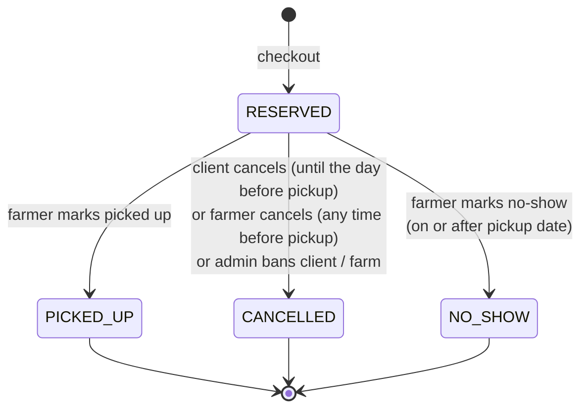

# ADR-004: Multi-farm cart, one order per farm at checkout

| | |
|---|---|
| **Status** | Proposed: depends on the product owner's answers to Q1, Q2 and Q4 |
| **Date** | 2026-10-27 |
| **Deciders** | Michal Jaros (student), with Claude as architecture consultant |
| **Depends on** | [ADR-001](ADR-001-modular-monolith.md) §2.6 (checkout as one transaction) |
| **Stories** | 9, 10, 11, 12, 40, 41 |
| **Open questions** | Q1 multi-farm cart · Q2 allowed pickup dates · Q4 order lifecycle (notes §6) |

---

## 1. Context

The cart and ordering stories are short:

* US 9–11: a client adds products to a cart, removes them and sees the cart.
* US 12: a client completes an order "so that I can choose a date to go and pick up the products".
* US 40, 41: the client and the farm see their orders.

They leave several design questions open, and the answers shape the Cart and Ordering modules:

1. **Q1. Can one cart contain products from several farms?** US 8 shows products per farm, which suggests shopping one farm at a time. But nothing forbids a client from adding tomatoes from farm A and cheese from farm B.
2. **Pickup happens at the farm.** Two farms are two places, so a single pickup date for a mixed cart does not make sense.
3. **Q2. Which pickup dates are allowed?** The stories say only "select a day".
4. **Q4. What happens after an order is placed?** Can it be cancelled? Does the farm mark it as picked up? US 41 says only that the farmer can "see" orders.
5. **Where does the cart live?** In the browser, or on the server?
6. **When is stock reserved?** When an item is added to the cart, or at checkout?

---

## 2. Decision

### 2.1 Cart

* **The cart is stored on the server** in `cart.cart_item (client_id, product_id, quantity, added_at)`. It survives reloads, logouts and device changes, which fits US 11 ("see the products in my cart") and the "stay logged in" stories.
* **A cart may contain products from several farms** (default answer to Q1).
* **The cart does not reserve stock.** Adding to the cart only checks that the product is `ACTIVE` and that the requested quantity is not more than what is available *now*. Stock is reserved only at checkout ([ADR-001](ADR-001-modular-monolith.md) §2.6).
* **The cart shows live data.** `GET /api/cart` returns each line with the product's **current** price and availability, and a flag on lines that are no longer available or have less stock than requested. The client sees problems before checkout, not only as a `409` at checkout.
* The cart is **grouped by farm** in the API response and the UI, because each group becomes a separate order with its own pickup date.
* Quantities must be positive and respect the product's unit (whole numbers for `piece`; up to three decimals for `kg` and `litre`).
* Cart lines for a product that is archived are kept but flagged, so the client understands why it disappeared; they are removed at checkout or by the client.

### 2.2 Checkout: one order per farm, all or nothing

* `POST /api/orders` takes **one pickup date per farm** in the cart:
  ```json
  { "pickups": [ { "farmId": "…", "pickupDate": "2026-10-31" },
                 { "farmId": "…", "pickupDate": "2026-11-02" } ] }
  ```
  Every farm in the cart must have exactly one pickup date.
* Checkout creates **one order per farm**. Each order belongs to exactly one client and one farm, and has one pickup date and its own status. This keeps US 41 ("farmer sees my orders") simple: a farmer sees only orders that are entirely theirs, never another farm's lines.
* Checkout is **all or nothing**: the whole cart is reserved in one transaction (ADR-001 §2.6). If any line cannot be reserved, nothing is reserved, no order is created, and the response is `409 Conflict` listing the problem lines. The client fixes the cart and tries again.
* Order lines store a **snapshot** of product name, unit and unit price. The price the client pays at pickup is the price at checkout, even if the farmer changes it later (US 16).
* The order total is computed by the server, never taken from the request.
* All orders from one checkout share a `checkout_id`, so the client's order list can show them together.
* **Idempotency:** the SPA sends an `Idempotency-Key` header with checkout. A repeated request with the same key (double click, network retry) returns the original result instead of creating duplicate orders.

### 2.3 Pickup dates (default answer to Q2)

* A pickup date must be **from tomorrow up to 14 days ahead**, in the farm's local time zone.
* Farms may later define **opening days** in Directory; the rule then becomes "a day the farm is open". The validation lives in one place in Ordering (`PickupDatePolicy`), so this is a local change.
* Pickup is a **date**, not a time slot. Time slots are a possible future feature.

### 2.4 Order lifecycle (default answer to Q4)



| Transition | Who | Stock effect |
|---|---|---|
| → `RESERVED` | client, at checkout | decreased (reserved) |
| `RESERVED` → `PICKED_UP` | farmer | none (already decreased) |
| `RESERVED` → `CANCELLED` | client until the day before pickup; farmer before pickup; system on ban (ADR-003 §2.3) | **released** back to the product, in the same transaction |
| `RESERVED` → `NO_SHOW` | farmer, on or after the pickup date | **released** (the produce is still at the farm) |

* Orders not marked by the farmer within **7 days after the pickup date** are automatically set to `NO_SHOW` by a nightly job, releasing stock.
* Once released, stock is returned only if the product is still `ACTIVE`; for an archived product the release is recorded but has no effect.
* Status changes publish `OrderCancelled`, `OrderPickedUp`, `OrderNoShow` as side-effect events (for hot products and future notifications).
* The new endpoints (`POST /api/orders/{id}/cancel`, `POST /api/farm/orders/{id}/picked-up`, `POST /api/farm/orders/{id}/no-show`) go beyond the written stories. They are needed to keep stock correct; without them, reserved stock would never come back after a cancellation or no-show.

---

## 3. Options considered

### 3.1 Cart scope (Q1)

| Option | Pros | Cons | Verdict |
|---|---|---|---|
| **Multi-farm cart, split into one order per farm (chosen)** | most flexible for the client; matches how people shop at a market; farmer sees only their own orders | client picks several dates at checkout; checkout UI slightly more complex | **Chosen** |
| Single-farm cart (adding from another farm asks to empty the cart) | simplest model: one cart = one order = one pickup | annoying when a client wants produce from two nearby farms; probably surprising | Fallback if the product owner prefers it; the model in §2 already supports it, only a validation rule changes |
| One order with lines from several farms and one pickup date per line | one order number for the client | farmer views must filter other farms' lines out; status per farm inside one order gets complicated | Rejected |

### 3.2 When failures happen at checkout

| Option | Verdict |
|---|---|
| **All or nothing (chosen)** | simple, predictable, matches one transaction; the client always decides what to do about missing items |
| Partial success: create orders for farms whose lines are available, report the rest | can surprise the client with an order they did not intend on its own; more complex responses. Rejected. |

### 3.3 Cart storage

| Option | Verdict |
|---|---|
| **Server-side table (chosen)** | survives devices and logouts; the server can show live availability; one more module to build, but it is small |
| Browser `localStorage` | no server code, but lost on another device, and the stale cart is only discovered at checkout. Rejected. |

### 3.4 When stock is reserved

| Option | Verdict |
|---|---|
| **At checkout (chosen)** | no "abandoned cart" holding stock; simple |
| When added to the cart, with a time limit | protects the client from losing items, but abandoned carts block stock for others and need an expiry job. Rejected for a low-traffic local market. |

---

## 4. Consequences

### 4.1 Positive

* **Clear ownership of orders:** each order belongs to one farm, so farmer views, permissions and status changes stay simple.
* **Stock stays correct over the whole lifecycle:** reserved at checkout, released on cancel and no-show, never left stranded.
* **No surprises at checkout:** the cart shows live availability, and checkout either succeeds completely or changes nothing.
* **Price certainty for the client:** the price at checkout is the price at pickup.
* **Robust against double submission** thanks to idempotency keys.
* **Single-farm-cart fallback is cheap**: if the product owner answers Q1 with "no", only one validation rule is added.

### 4.2 Negative, and how they are handled

| Cost | Mitigation |
|---|---|
| Checkout UI must ask for one date per farm | group the cart by farm; one date picker per group; default each to the first allowed date |
| A client can lose an item between adding it and checking out | live availability in the cart view; clear `409` message with the affected lines |
| Statuses and endpoints beyond the written stories (cancel, picked-up, no-show) | flagged here and in notes Q4 for product owner confirmation; small, contained in Ordering |
| Nightly jobs (auto no-show) add scheduled work | one scheduled task in Ordering; idempotent; covered by a test |
| One checkout creates several orders and several order numbers | `checkout_id` groups them in the client's order list |

---

## 5. Compliance

Integration tests must cover:

* A cart with lines from two farms produces two orders, each with its own pickup date and only its own lines.
* If one line is unavailable, checkout returns `409`, no order exists, and stock is unchanged for every product.
* A repeated checkout with the same `Idempotency-Key` creates no extra orders.
* Cancelling an order restores stock; a client cannot cancel on the pickup day.
* A pickup date of today or more than 14 days ahead is rejected.
* A farmer cannot change the status of another farm's order.

---

## 6. When to revisit

* The product owner answers Q1, Q2 or Q4 differently from the defaults here.
* Online payment is added: checkout gains a payment step, and the all-or-nothing transaction may have to become a two-step "reserve, then confirm payment".
* Pickup time slots are added: `pickupDate` becomes a reference to a slot owned by Directory, with capacity per slot.
