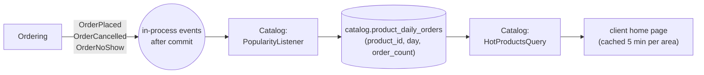

# ADR-005: "Hot products" = recently most-ordered in the client's area, with an in-season fallback

| | |
|---|---|
| **Status** | Proposed: depends on the product owner's answer to Q3 |
| **Date** | 2026-10-27 |
| **Deciders** | Michal Jaros (student), with Claude as architecture consultant |
| **Depends on** | [ADR-001](ADR-001-modular-monolith.md) §2.4 (events), §2.5 (data ownership); [ADR-004](ADR-004-cart-and-order-per-farm.md) (order lifecycle) |
| **Stories** | 6 |
| **Corrects** | the hot-products SQL in notes §5.6.4 (see §1.3) |

---

## 1. Context

### 1.1 The requirement

> US 6: *As a Client, I want to see Hot products, so that I can discover the product in the season.*

"Hot" is not defined. The "so that" part points to **seasonality** ("the product in the season"); the word "hot" usually means **popular right now**. The two are related: produce that is in season is what people are ordering.

### 1.2 Constraints

* **Local:** the client can only pick up from farms in or near their area, so a product popular in another area is useless to them.
* **Cold start:** at launch, and in a newly added area, there are no orders yet.
* **Units differ:** products are sold per `kg`, `piece` or `litre`. Adding 3 kg of potatoes to 12 eggs is meaningless.
* **Module boundaries** (ADR-001 §2.4, §2.5): hot products belong to **Catalog**, but order data belongs to **Ordering**, and Ordering depends on Catalog, not the other way round.
* **Privacy:** NFFH does not track page views or clicks, and adding tracking would add GDPR consent work.
* **Cheap to compute:** it is shown on the client's home page, so it is read often.

### 1.3 Problems in the first draft (notes §5.6.4)

The query sketched in the architecture notes has three problems this ADR fixes:

1. **The 14-day window does not filter anything.** The date condition is on a `LEFT JOIN` to `orders`, so order lines from any date are still counted.
2. **It sums quantities across different units**, so a product sold by the piece beats one sold by the kilogram for no real reason.
3. **Catalog reads Ordering's tables directly**, which breaks ADR-001's data-ownership rule and reverses the module dependency.

---

## 2. Decision

### 2.1 Definition

A product's **hotness** in an area is the **number of distinct orders** that included it in the **last 14 days**, counting orders in status `RESERVED` or `PICKED_UP` (not `CANCELLED` or `NO_SHOW`), at farms in that area.

Counting **orders**, not quantities, makes products with different units comparable, and stops one very large order from dominating.

### 2.2 The list shown to the client

`GET /api/products/hot` returns **up to 12 products** from farms in the client's home area, chosen as follows:

1. Only products that are `ACTIVE`, have `quantity_available > 0`, and whose farm's owner is `ACTIVE`.
2. Products with hotness ≥ 1, ordered by hotness (highest first), then by `in_season = true` first, then by newest.
3. **At most 3 products per farm**, so one big farm does not fill the whole list.
4. If fewer than 12 remain, fill up with **in-season products** (the farmer's `in_season` flag), newest first, still at most 3 per farm. This is the cold-start fallback.
5. Each item in the response carries a `reason`: `POPULAR` or `IN_SEASON`, so the UI can label it ("Popular this week" / "In season").

### 2.3 How it is computed, respecting module boundaries

Catalog keeps its **own** popularity counts, fed by events from Ordering, instead of reading Ordering's tables.



* `catalog.product_daily_orders (product_id, day, order_count)` holds one row per product per day.
* `OrderPlaced` (with the order's product ids) adds 1 for each product for the order's day. `OrderCancelled` and `OrderNoShow` subtract 1 for the same day. These are **side-effect events** (ADR-001 §2.4): after commit, recorded in the outbox and retried, so counts are not lost on a crash.
* The hot-products query sums `order_count` over the last 14 days, joined with Catalog's own `product` table and Directory's public interface for the farms in the area:

  ```sql
  -- :farmIds = active farms in the client's area, from Directory's api
  SELECT p.id, p.farm_id, p.in_season, p.created_at,
         COALESCE(SUM(d.order_count), 0) AS hotness
  FROM catalog.product p
  LEFT JOIN catalog.product_daily_orders d
         ON d.product_id = p.id
        AND d.day >= CURRENT_DATE - 13          -- filter in the JOIN, on the table being counted
  WHERE p.farm_id = ANY(:farmIds)
    AND p.status = 'ACTIVE'
    AND p.quantity_available > 0
  GROUP BY p.id
  ```

  The ranking, the per-farm limit and the in-season fill-up (§2.2 steps 2–4) are applied in Java on this small result set, where they are easy to read and unit-test.
* The result is **cached in memory for 5 minutes per area**. Staleness is harmless here (ADR-001 §2.1). A product that sells out may stay in the list for up to 5 minutes; the product page shows the real stock.
* Rows older than 30 days are deleted by a nightly job.
* A one-off **rebuild command** recomputes the table from Ordering's public interface (`Ordering.countOrdersByProductAndDay(since)`), for first deployment and for repair.

### 2.4 What farmers and admins can influence

* Farmers set the `in_season` flag on their products (part of US 14, 16). This only affects the fallback and tie-breaks; it cannot push a product above genuinely popular ones.
* There is no admin curation in v1. Adding a "featured" flag later is a small change to the ranking.

---

## 3. Options considered

| Option | Pros | Cons | Verdict |
|---|---|---|---|
| **Order count in area over 14 days + in-season fallback (chosen)** | reflects real local demand; works from day one thanks to the fallback; no tracking; comparable across units | needs an event-fed counter table | **Chosen** |
| In-season flag only | trivial | depends entirely on farmers maintaining the flag; nothing is "hot", just "available"; every in-season product is equal | Rejected as the main rule, kept as fallback |
| Sum of reserved quantity | simple to describe | meaningless across units (kg vs pieces) | Rejected |
| Fixed seasonal calendar (e.g. "strawberries: May–June") | no farmer effort | needs a product taxonomy NFFH does not have; regional climate differences | Rejected |
| Page views / clicks | captures interest before orders | needs tracking, consent and storage; NFFH has none | Rejected |
| Admin curated list | full control | manual work per area, every week; no story for it | Rejected for v1 |
| Personal recommendations (per client) | most relevant | needs history and ML; far beyond the scope of a 41-story platform | Rejected |
| Cross-schema SQL view reading Ordering's tables (first draft) | no events, always exact | breaks data ownership and dependency direction (ADR-001 §2.4, §2.5) | Rejected |

---

## 4. Consequences

### 4.1 Positive

* **US 6 has a precise, testable definition** that matches both "hot" and "in the season".
* **Works on day one** and in new areas, via the in-season fallback.
* **Respects ADR-001:** Catalog does not read Ordering's tables, and no dependency cycle is introduced.
* **Cheap:** a small table, a short query, a 5-minute cache.
* **Fair across farms and units:** order counts plus a per-farm limit.
* **No tracking of user behaviour**, so no extra GDPR consent.

### 4.2 Negative, and how they are handled

| Cost | Mitigation |
|---|---|
| Counts are **eventually consistent** (updated after commit, cached 5 min) | acceptable for a discovery list; documented here |
| A lost or duplicated event would skew counts | the outbox retries lost events; listeners are idempotent per `(order_id, event type)`; the rebuild command repairs drift |
| More moving parts than a single SQL view | one listener class, one table, one query, all inside Catalog and covered by tests |
| In an area with very few orders, one order makes a product "hot" | acceptable; the `reason` label is honest about it. A minimum threshold can be added later. |
| Depends on farmers using the `in_season` flag for the fallback | make the flag visible and easy to toggle in the farmer's product list |

---

## 5. Compliance

Tests must cover:

* An order older than 14 days does not count.
* Cancelled and no-show orders do not count.
* A product sold by the piece and one sold by the kilogram, each in 3 orders, have equal hotness.
* No more than 3 products from one farm appear.
* With no orders at all, the list contains in-season products only, labelled `IN_SEASON`.
* Sold-out and archived products never appear (after cache expiry).
* The Spring Modulith verification still passes (Catalog has no dependency on Ordering's internals).

---

## 6. When to revisit

* The product owner defines "hot" differently (Q3).
* Areas become large enough that popularity per area is too coarse (e.g. a distance-based radius is introduced).
* Clients ask for personal recommendations, or a product taxonomy (categories) is introduced, making seasonal calendars possible.
