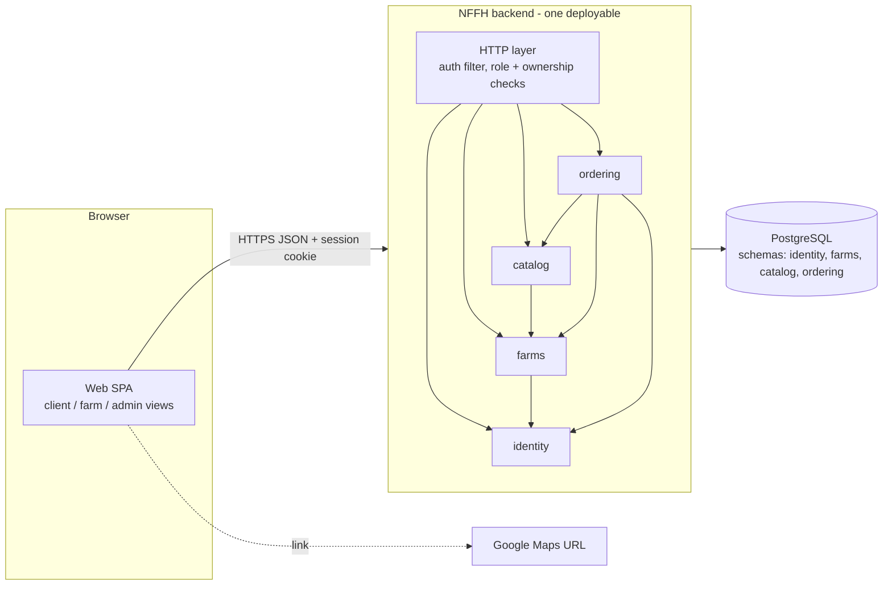
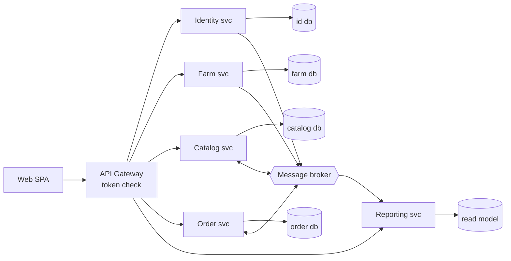
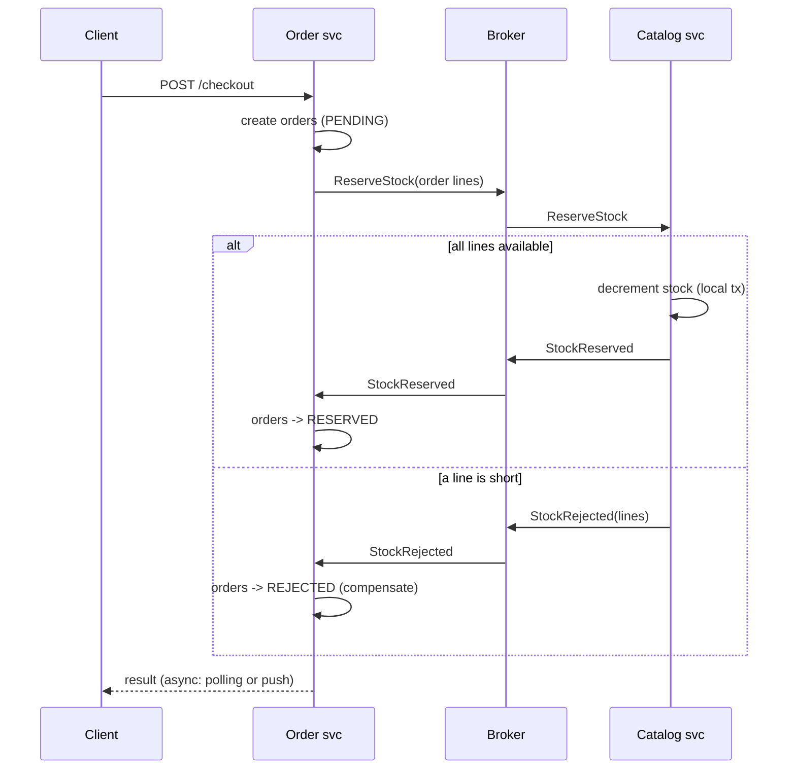
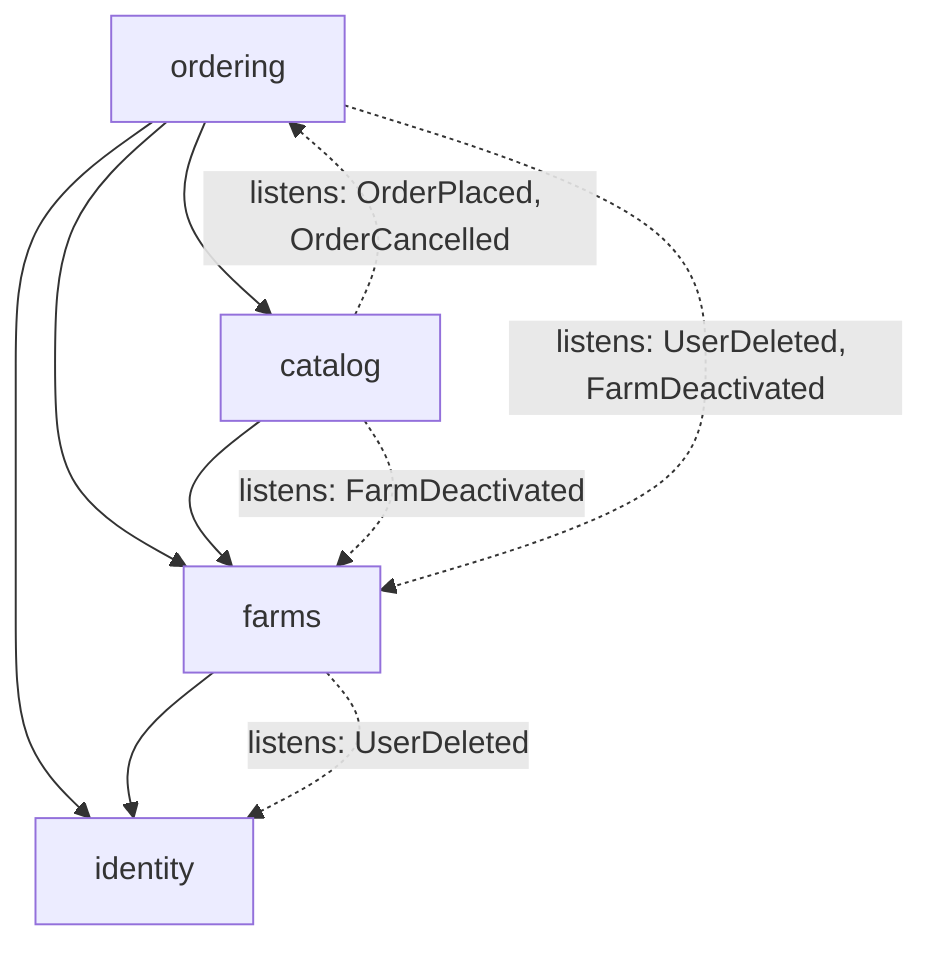
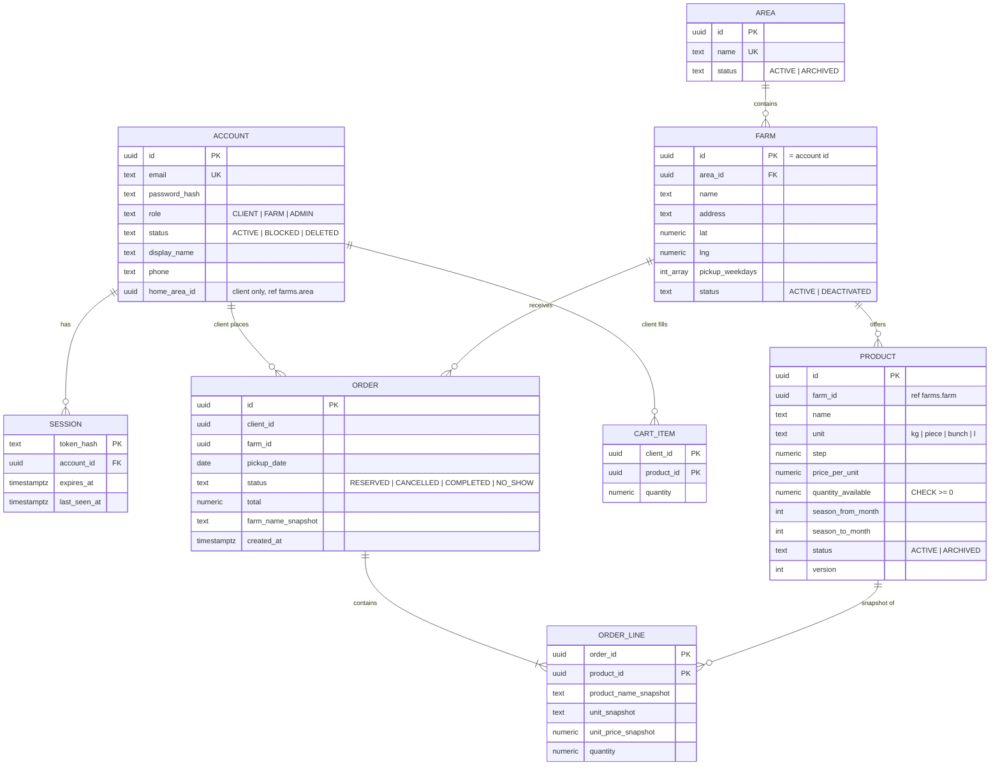
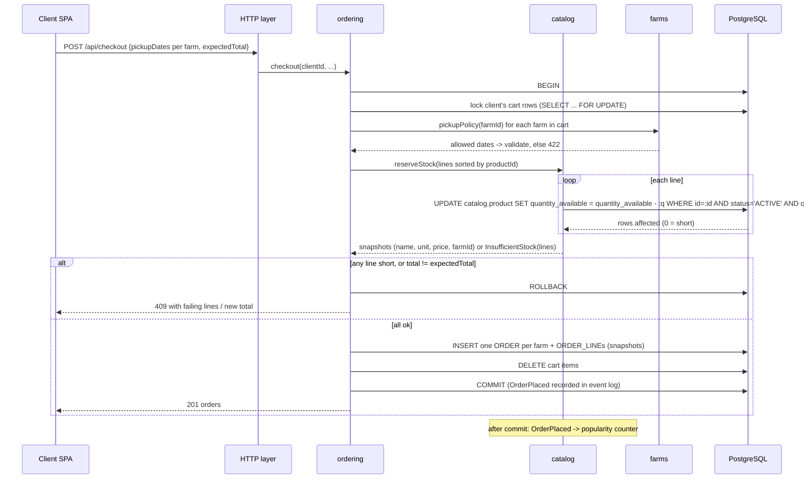
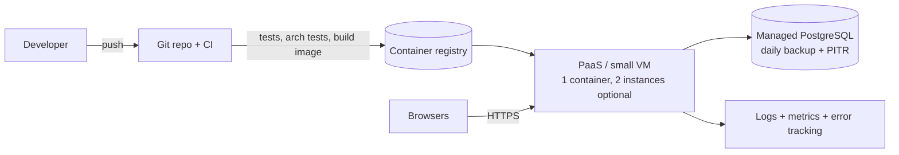

# NFFH — Architecture Notes (new session)

| | |
|---|---|
| **Project** | **Not Far(m) From Home (NFFH)**: a "km 0" platform where local farms list fresh produce and clients reserve it for pickup at the farm |
| **Requirements source** | [../Tasks/data/NFFH.txt](../Tasks/data/NFFH.txt) |
| **Date** | 2026-10-27 |
| **Participants** | michaljaros · Claude (architecture consultant) |
| **Result** | **Option A — Modular monolith** recommended: 156 / 185 (84.3 %) vs. Serverless/BaaS 135 (73.0 %) and Microservices 90 (48.6 %). Recorded in [adr/](adr/README.md) (ADR-001 … ADR-007) |
| **Previous conversation** | None used. This is a fresh session on purpose. Earlier outputs in `Week_05_Designing/` were not read (see 0.2) |
| **Companion notes** | [Session_conversation_notes.md](Session_conversation_notes.md) (whole session, meta decisions) · [NFFH_ADR_conversation_notes.md](NFFH_ADR_conversation_notes.md) (stage 3) |

---

## 0. Conversation log

### 0.1 The request (verbatim)

> *"use skills described in .claude to make a proposial of architecture of requirements in @Week_05_Designing/Tasks/data/NFFH.txt , save every output into new folder called new_session, make notes of this converastion and taken decisions"*

### 0.2 What was done, step by step

1. Read the skills in `.claude/skills/`: `architecture-decision` (the orchestrator), `architecture-requirements-analysis`, `architecture-options`, `adr-writer`, and their templates.
2. Read the requirements file `Week_05_Designing/Tasks/data/NFFH.txt` (system description + 41 user stories).
3. Did **not** read `Tasks/Task_1.md` … `Task_3.md`. The user named only NFFH.txt.
4. Did **not** read the earlier outputs `Week_05_Designing/NFFH_architecture_notes.md`, `NFFH_ADR_conversation_notes.md`, `Architecture_skills_conversation_notes.md` or `Week_05_Designing/adr/`. The orchestrator skill says to continue earlier notes. The user asked for a *new* folder, which I read as a fresh, independent run, so nothing here is copied from those files.
5. Stage 1 (`architecture-requirements-analysis`): section 1 below.
6. Stage 2 (`architecture-options`): sections 2–6 below.
7. Stage 3 (`adr-writer`): seven ADRs in [adr/](adr/README.md). Its log is in [NFFH_ADR_conversation_notes.md](NFFH_ADR_conversation_notes.md).

### 0.3 TL;DR

* NFFH is a small, regional, CRUD-heavy marketplace with **one real consistency risk**: two clients reserving the last stock of a product at the same time (story 12).
* The requirements contain **no NFRs**. Scale, budget, team and availability are assumed (section 1.4) and listed as open questions (section 1.8).
* Three structurally different options compared: **A Modular monolith**, **B Microservices**, **C Serverless / BaaS**.
* **A wins** (84.3 %), mainly because one ACID transaction makes the checkout safe, one database answers the admin's cross-entity queries (26–34), and it is the cheapest to build and run for a small team.
* It holds under all three sensitivity re-weightings. Under "demo in two weeks", C comes within 4.2 points, so a team that already knows a BaaS well could pick C.
* Main sub-decisions: 4 business modules (**identity, farms, catalog, ordering**), "admin is a role, not a module", one PostgreSQL with one schema per module, server-side revocable sessions in a cookie, **one order per farm** with an atomic conditional stock decrement, soft delete everywhere.

---

## 1. Requirements analysis

### 1.1 The system in one sentence

Farms publish their produce with price and available quantity. Clients browse farms and products in their area, put products in a cart, and complete an order that **reserves** the stock and fixes a **pickup date** at the farm. An administrator maintains users, areas and products and looks at platform-wide data.

**Out of scope (and that removes complexity):** no online payment (assumed: pay at pickup), no delivery or logistics, no messaging between users, no ratings, no native mobile app. Google Maps is only a link to open (story 13), not an embedded map or a geocoding integration.

### 1.2 Actors

| Actor | Names used in the stories | Stories | Count |
|---|---|---|:-:|
| Client (consumer) | "Client", "client" | 1–13, 40 | 14 |
| Farm | "Agricultural Company", "farmer" | 14–21, 41 | 9 |
| Administrator | "Administrator of the site" | 22–39 | 18 |
| Google Maps (external) | "google Maps" | 13 | — |

Total 41 stories. "Farmer" (41) and "Agricultural Company" (14–21) are treated as the same actor. **Assumption:** one farm = one user account.

### 1.3 Stories grouped by capability

| # | Capability | Stories | Notes for the architect |
|---|---|---|---|
| C1 | Identity and sessions | 1, 2, 3, 4, 18, 19, 20, 22, 23, 24 | "Don't re-enter credentials on reload" (3, 19, 23) needs a **persistent session**. Logout (4, 20, 24) plus admin delete/modify (25, 29) means sessions must be **revocable on the server**. There is no admin registration story, so admins are seeded. Farm registration (17) also creates an account, but it is grouped under C3 because it mainly creates the farm profile. |
| C2 | Own profile | 5, 21 | Read-only in the stories. No "edit my profile" story, see Q13. |
| C3 | Farm directory and areas | 7, 13, 17, 30, 31, 32, 35, 39 | "**My area**" is undefined (Q2). Areas are admin-managed (35, 39). **Integrity:** deleting an area that farms point to (39), see Q12. 13 needs a stored address or coordinates. |
| C4 | Catalog and inventory | 6, 8, 14, 15, 16, 33, 34, 36, 37, 38 | "**Hot products**" is undefined (Q1). **Ownership:** a farm may change only its own products (14–16). An admin may change any product (36–38). **Integrity:** removing a product that is in carts or past orders (15, 38). Farms and admins writing stock at the same time as checkout (16 vs. 12). |
| C5 | Cart | 9, 10, 11 | A cart can hold products of several farms (8 → 9). Does adding to the cart reserve stock? Assumed: **no**, only checkout reserves. |
| C6 | Ordering (reservation + pickup) | 12, 40, 41 | **The consistency-critical workflow.** Concurrent checkouts on limited stock. Prices can change while items sit in the cart (16). Pickup is "at the Agricultural Company", so a multi-farm cart has to split (Q3). Pickup-date rules undefined (Q4). No cancel or "picked up" story (Q6). |
| C7 | Admin: user management | 25, 27, 28, 29 | "Delete malevolent user" when the user has orders, products and sessions. Needs soft delete and anonymisation (GDPR, Q11). |
| C8 | Admin: reporting | 26 | One story, but it needs **cross-entity queries**: orders with client, farm and area. Stories 27, 31, 33 are also cross-entity lists. In total **9 stories** (26–28, 31–34, 40, 41) are lists or lookups over several entities. |

Total: C1 10 + C2 2 + C3 8 + C4 10 + C5 3 + C6 3 + C7 4 + C8 1 = **41**. Every story appears in exactly one group. **All 41 stories covered.**

### 1.4 What the requirements do not say (inferred NFRs, all **assumptions**)

| Topic | Missing | Inferred value *(assumption)* | Reasoning |
|---|---|---|---|
| Scale | Users, farms, orders | One region at launch. ≤ 5,000 clients, ≤ 200 farms, ≤ 2,000 products, ≤ 500 orders/day, ≤ 100 concurrent users | "km 0" and "farms in my area" point to a local or regional platform |
| Performance | Response times | Browse p95 < 500 ms. Checkout p95 < 1 s. Admin reports < 2 s | Normal web expectations at this scale |
| Availability | Uptime, support hours | 99.5 % per month. Short planned maintenance at night is fine | Reservations for a later day. A short outage loses no money because nothing is paid online |
| Durability | Backups | RPO 24 h, RTO 4 h. Daily backup plus point-in-time recovery if the managed DB offers it | Orders are the only valuable data |
| Security | Nothing stated | HTTPS only. Hashed passwords (Argon2id or bcrypt). Role-based **and ownership** checks. Login rate limiting. Audit log of admin actions | Three roles, admin can delete users, personal data |
| Privacy / regulation | Nothing stated | **GDPR applies** (the spelling "Agricoltural" hints at Italy/EU). Data minimisation, right to erasure (fits 25), privacy notice | Personal data: name, email, phone, address |
| Payment | Not mentioned | None online. Paid at the farm on pickup | No story mentions payment |
| Notifications | Not mentioned | None in v1. Email is optional later | No story mentions it |
| Clients and devices | Not stated | Responsive web app. Phone-first for clients, desktop for admin | Clients shop on phones. Farms update stock on phones |
| Languages | Not stated | Italian + English | Hint above |
| Team, deadline, budget | Not stated | 2–4 student/startup developers, one semester, hosting ≤ €30/month | Course context |
| Evolution | Not stated | Likely next: online payment, cancellations, notifications, ratings, more regions | Typical for marketplaces |

### 1.5 Architectural drivers

| # | Driver | Weight (1–5) | Why (traced) |
|---|---|:-:|---|
| D1 | **Consistency of the reservation workflow** (stock never negative, no double-selling, price snapshot) | **5** | Story 12, with 9–11 and 14–16 changing the same stock. This is the only place where a bug hurts real people (a client drives to the farm for produce that is gone). |
| D2 | **Simplicity / time-to-market** | **5** | 41 mostly CRUD stories, small team, one semester (assumed, 1.4). Complexity that does not buy a requirement is pure cost. |
| D3 | Security and access control (authN, persistent revocable sessions, RBAC + ownership) | 4 | 1–4, 17–20, 22–25, 29. Three roles. Farms may change only their own products (14–16). The admin can delete users (25). |
| D4 | Cross-entity queries and reporting | 4 | 26–28, 31–34, 40, 41: 9 stories list or look up across users, farms, areas, products and orders. |
| D5 | Low operational cost and effort | 4 | Small budget, nobody on call (assumed). |
| D6 | Modifiability / evolution | 3 | Payment, cancellation and notifications are likely next (1.4). Moderate, because no change is announced. |
| D7 | Testability | 3 | The checkout rules and ownership rules need automated tests. A course project is graded on quality. |
| D8 | Data integrity on deletion | 3 | 15, 25, 38, 39 delete things that orders and farms reference. 40 and 41 must still show history. |
| D9 | Scalability | **2** | Low on purpose: regional platform, ≤ 100 concurrent users (assumed). One server is enough by a wide margin. |
| D10 | Availability | **2** | Low on purpose: reservations for a later day, no online payment. A short outage is an annoyance, not a loss. |
| D11 | Vendor independence / portability | 2 | Student or startup project. Avoid being locked into one cloud's proprietary services, but it is not critical. |

Σ weights = **37**. Maximum score = 37 × 5 = **185**. These weights are reused unchanged in section 3.3.

Interoperability (Google Maps, 13) is not a driver: a URL link is enough, so it does not shape the architecture.

### 1.6 Quality-attribute scenarios

| # | Driver | Source → Stimulus | Environment | Response | Measure |
|---|---|---|---|---|---|
| QAS1 | D1 | Two clients → check out the last 2 kg of tomatoes at the same moment | Normal load | Exactly one order succeeds. The other client gets "only 0 kg left" and the cart stays intact | Stock never < 0. Proved by an automated concurrency test with 50 parallel checkouts |
| QAS2 | D1 | Farm → changes the price while a client has the item in the cart | Normal | Checkout shows the new total and asks for confirmation. The order stores the price the client confirmed | 0 orders with a price the client did not see |
| QAS3 | D1 | Client → checks out a cart with products of 2 farms, and one product has run out | Normal | No order is created for either farm (all-or-nothing). The client sees which line failed | 0 partial checkouts |
| QAS4 | D3 | Client → closes the browser and comes back 3 days later | Normal | Still logged in, no credential prompt | Session lifetime 30 days sliding *(assumed)* |
| QAS5 | D3 | Admin → deletes a malevolent user who is logged in on 2 devices | Normal | The user's next request on both devices is rejected (401) | Revocation effective on the next request |
| QAS6 | D3 | Farm A → sends `PUT /products/{id}` for a product of farm B | Attack / bug | 403, nothing changed, event logged | 100 % of ownership checks covered by tests |
| QAS7 | D4 | Admin → opens "all orders" for a month, filtered by area | 50,000 orders in DB *(assumed)* | Paged list with client, farm and area names | < 2 s *(assumed)* |
| QAS8 | D2/D5 | Team → deploys a new version | Working day | One command or CI job, no manual steps | < 10 min, rollback < 5 min *(assumed)* |
| QAS9 | D8 | Farm → removes a product that appears in 30 past orders | Normal | The product disappears from the catalog. Past orders still show its name, unit and price | 0 broken order views |
| QAS10 | D6 | Product owner → asks for online payment | 1 year after launch | Added as a new module plus a new order state. Catalog, farms and identity unchanged | ≤ 3 weeks for 2 developers *(assumed)* |

### 1.7 Working assumptions

* One farm = one user account with role `FARM`. One client = one account with role `CLIENT`. Admins (`ADMIN`) are seeded or created by another admin, never self-registered.
* A client has **one home area**. A farm belongs to **exactly one area**. Areas are created by the admin (35).
* Adding to the cart does **not** reserve stock. Checkout does.
* Every product has a **unit** (kg, piece, bunch, litre…). Quantities are decimals in that unit. Quantities of different units are never added together.
* Payment happens at the farm. The platform never handles money.
* A farm's "orders" (41) are the orders placed with it. A client's "orders" (40) are their own.

### 1.8 Open questions for the product owner

| # | Question | Affects | Proposed default |
|---|---|---|---|
| Q1 | What makes a product "hot" (6)? | catalog, ordering | A product is hot if it is **in season this month** (the farm sets a month range). Hot products are ranked by **number of order lines in the last 14 days** in the client's area. See ADR-005 |
| Q2 | What is "my area" (7)? Admin-defined regions, or a distance radius? | farms, identity | Admin-defined named areas (35, 39). The client picks a home area at registration and can browse other areas. See ADR-006 |
| Q3 | Can one checkout contain products of several farms? | ordering | Yes. Checkout creates **one order per farm**, each with its own pickup date, all-or-nothing. See ADR-004 |
| Q4 | Which pickup dates are allowed? | ordering, farms | From tomorrow up to 14 days ahead, on the farm's declared pickup weekdays (all days if none declared) |
| Q5 | Is online payment in scope? | ordering | No. Pay at pickup |
| Q6 | Can a client cancel? Can a farm mark an order picked up or no-show? | ordering, catalog | Proposed new stories: the client cancels until the day before pickup and the stock comes back. The farm marks an order `COMPLETED` or `NO_SHOW` |
| Q7 | Any notifications (email on order)? | new module | None in v1 |
| Q8 | Expected scale and launch region? | all | See 1.4 |
| Q9 | Required availability and support hours? | deployment | 99.5 %, best-effort support |
| Q10 | Must the admin approve a new farm before it is visible (17)? | farms | No. Visible right away, as story 17 says. The admin can delete it (25) |
| Q11 | What does "delete a user" (25) mean for order history? | identity, ordering | Soft delete + anonymisation. Future reservations cancelled, stock returned. Past orders kept without personal data. See ADR-007 |
| Q12 | What happens when an area with farms is deleted (39)? | farms | Refused until its farms are moved to another area. See ADR-006 |
| Q13 | What can the admin change on a user (29)? Can users edit their own profile? | identity | Admin: name, contact data, block/unblock, force logout. Not the password, not the role. Users: proposed new "edit my profile" story |
| Q14 | Team size and skills, deadline, budget? | ADR-002 stack, hosting | 2–4 developers, one semester, ≤ €30/month |
| Q15 | Languages and devices? | frontend | IT + EN, responsive web |
| Q16 | Units and minimum order step per product? | catalog | Unit per product. The farm sets a step (e.g. 0.5 kg) |

---

## 2. Candidate architectures

### 2.1 The three candidates

They differ on the axes that matter here: **how many deployables**, **who owns the data** (one database or one per service), and **who runs the infrastructure**.

| Option | Deployable units | Databases | Who runs the infrastructure |
|---|---|---|---|
| **A. Modular monolith** | 1 backend (+ static SPA served by it) | 1 PostgreSQL, one schema per module | Team, on one small PaaS/VM + managed Postgres |
| **B. Microservices** | API gateway + 5 services + message broker | 1 database per service | Team, on Kubernetes or several PaaS apps |
| **C. Serverless / BaaS** | SPA + a few edge functions | 1 managed PostgreSQL with row-level security | The BaaS provider (managed auth, DB, functions) |

### 2.2 Styles considered but not shortlisted

| Style | Why not shortlisted |
|---|---|
| Classic layered monolith (controller/service/repository for the whole app) | Same deployment as A without module boundaries. A is the same idea with a modifiability guard, so A replaces it |
| Hexagonal / clean architecture | It organises code *inside* a deployable, so it is complementary. Used inside A's modules where useful (the checkout), not a competing option |
| Event-driven with event sourcing / CQRS | No audit, temporal-query or high-throughput requirement. Event sourcing makes the simple "stock ≥ 0" rule harder |
| Micro-kernel / plugin | No third-party extensions are required |
| Space-based | Built for huge, spiky load. The opposite of a regional platform |
| Offline-first / edge | No offline requirement. Stock must be checked online at checkout anyway |

### 2.3 Option A — Modular monolith

**Idea.** One application, one process, one database, but split inside into four business modules with hard boundaries: each module owns its tables, and other modules may only call its public interface. This gives the simplicity of a single app (one deploy, one transaction, one log) while keeping the code organised so a module can be pulled out later if it ever needs to be.



| Module | Owns | Stories |
|---|---|---|
| identity | accounts, credentials, roles, sessions | 1–5, 18–20, 22–25, 27–29 |
| farms | areas, farm profiles, addresses/coordinates, pickup weekdays | 7, 13, 17, 21, 30–32, 35, 39 |
| catalog | products, stock, season range, popularity counter | 6, 8, 14–16, 33, 34, 36–38 |
| ordering | carts, orders, order lines (snapshots) | 9–12, 26, 40, 41 |

**Critical workflow (checkout).** A single local ACID transaction. Ordering calls `catalog.reserveStock(...)`, which runs a conditional `UPDATE … WHERE quantity_available >= :qty` per line. If any line fails, the whole transaction is rolled back. See section 5.5 for the full sequence.

**Data.** One PostgreSQL. Each module has its own schema, and only that module's code has access to it (enforced by an architecture test, plus optionally a DB role per module). Other modules get data through the module's public API.

**Deployment.** One container on a PaaS or small VM, managed PostgreSQL with daily backups, CI builds and deploys on merge.

**Strengths for NFFH.**
* The checkout is an ordinary database transaction. QAS1 and QAS3 come almost for free and are easy to test.
* Admin lists (26–34) are simple module queries composed in one process. No distributed joins.
* One deployable and one database make it the cheapest to run and the fastest for a 2–4 person team.

**Weaknesses for NFFH.**
* Boundaries stay clean only if they are enforced (architecture tests in CI). Otherwise the app slides into a "big ball of mud".
* Scaling and failure are all-or-nothing. At ≤ 100 concurrent users that doesn't matter.
* Using one transaction across modules couples ordering and catalog. Acceptable, and the coupling is documented.

### 2.4 Option B — Microservices

**Idea.** Every capability is its own service with its own database, deployed independently behind an API gateway. Services talk over HTTP and through a message broker. Because no single database can cover the checkout, it becomes a **saga**: a sequence of local steps with compensating steps when something fails.



| Service | Owns | Stories |
|---|---|---|
| Identity | accounts, sessions/tokens | 1–5, 18–20, 22–25, 27–29 |
| Farm | areas, farms | 7, 13, 17, 21, 30–32, 35, 39 |
| Catalog | products, stock | 6, 8, 14–16, 33, 34, 36–38 |
| Order | carts, orders | 9–12, 40, 41 |
| Reporting | denormalised read model built from events | 26 (+ admin lists that join data) |

**Critical workflow.**



**Data.** Five databases. Admin queries across entities need the Reporting read model, which is **eventually consistent**.

**Deployment.** Gateway, 5 services, broker and 5 databases. In practice this means Kubernetes or a lot of PaaS apps, central logging and distributed tracing.

**Strengths for NFFH.** Independent scaling and deployment, fault isolation, and teams could own services. None of these is a stated need.

**Weaknesses for NFFH.**
* The one hard requirement (D1) turns from a local transaction into a saga with PENDING states, retries, idempotency and an asynchronous answer to the client.
* The 9 cross-entity stories need a separate read model fed by events, and it can be stale.
* Highest cost and ops effort, and needs more people than the assumed team.

### 2.5 Option C — Serverless / BaaS

**Idea.** Use a backend-as-a-service (for example Supabase-style: managed auth, managed PostgreSQL with row-level security (RLS), edge functions). The SPA talks to the database API directly. RLS policies decide who may read and write each row. The few operations that need server logic (checkout, admin deletion) are database functions or edge functions.

```mermaid
flowchart LR
  SPA[Web SPA] -- JWT --> AUTH[Managed Auth]
  SPA -- REST/RPC + JWT --> DBAPI[Auto-generated DB API]
  DBAPI --> PG[(Managed PostgreSQL<br/>RLS policies<br/>checkout() function)]
  SPA --> EF[Edge functions<br/>admin delete user, reports]
  EF --> PG
  EF --> AUTH
```

| Part | Owns | Stories |
|---|---|---|
| Managed auth | accounts, tokens, refresh | 1–4, 18–20, 22–24 |
| Tables + RLS | profiles, farms, areas, products, cart, orders | 5–11, 14–16, 21, 26–28, 30–38, 40, 41 |
| DB function `checkout()` | atomic reservation | 12 |
| Edge functions | admin delete/modify user (needs the service key), Maps link data | 13, 25, 29 |

**Critical workflow.** `checkout()` is a PL/pgSQL function run in one transaction with the same conditional `UPDATE` as A. So it is atomic, but the business logic lives in SQL.

**Data.** One managed PostgreSQL. Integrity uses real foreign keys. Ownership is enforced by RLS (`farm_id = auth.uid()`-style policies).

**Deployment.** Static hosting for the SPA, everything else managed. The free or low tier probably covers the assumed scale.

**Strengths for NFFH.** Fastest start, very low cost, nothing to operate, and auth with persistent sessions is built in.

**Weaknesses for NFFH.**
* Business rules end up split across RLS policies, SQL functions, edge functions and the SPA. That is hard to test and hard to change (D6, D7).
* One wrong RLS policy exposes data. Security depends on policies being reviewed table by table.
* JWT access tokens stay valid until they expire (minutes), so "delete user" (25) is not effective right away without extra work.
* Strong lock-in to the provider's auth and API (D11).

---

## 3. Comparison

### 3.1 Side by side

| Dimension | A. Modular monolith | B. Microservices | C. Serverless / BaaS |
|---|---|---|---|
| Deployables | 1 | ~7 + broker | SPA + few functions |
| Checkout consistency | Local ACID transaction | Saga, eventual | Local ACID (SQL function) |
| Cross-entity queries | Module queries in one process | Read model, eventually consistent | SQL views (subject to RLS) |
| Dev complexity | Low–medium | High | Low at first, rising with RLS logic |
| Ops complexity | Low | High | Very low |
| Cost at this scale | ~€10–25/month *(assumed)* | ~€100+/month *(assumed)* | €0–25/month *(assumed)* |
| Scalability ceiling | One big server + read replica (far beyond need) | Very high | High (provider) |
| Fault isolation | None inside the process | Good | Provider-level |
| Testability | High (in-process, real DB in tests) | Low–medium (contracts, e2e) | Low–medium (policies + SQL) |
| Modifiability | Good with enforced modules | Good per service, poor across services | Poor once logic is spread out |
| Lock-in | Low | Low–medium | High |
| Team size it suits | 1–8 | 3 teams+ | 1–3 |

### 3.2 How each option handles the hard parts

| Hard part (stories) | A. Modular monolith | B. Microservices | C. Serverless / BaaS |
|---|---|---|---|
| Last-stock race (12, QAS1) | Conditional `UPDATE` inside one transaction. The loser gets a clear message right away | Saga. The loser learns asynchronously. Needs idempotent handlers | Conditional `UPDATE` inside `checkout()`. Atomic |
| Multi-farm checkout all-or-nothing (QAS3) | Same transaction covers all farms' orders | Saga over N orders with compensation | Same SQL function |
| Price changed in cart (16, QAS2) | Compare expected total inside the transaction, return 409 | Order svc must ask Catalog for prices, which can change during the saga | Inside `checkout()` |
| Persistent but revocable session (3, 4, 25) | Server-side session row. Delete it and it is gone on the next request | Token + revocation list shared by the gateway | Managed JWT + refresh token. Revocation waits for access-token expiry |
| Ownership: own products only (14–16) | Explicit check in catalog service + tests | Explicit check in Catalog svc | RLS policy per table |
| Admin lists across entities (26–34) | Ordering lists orders, then one batch lookup of names from identity/farms | Reporting read model | Views. Admin needs an RLS bypass via edge function |
| Delete user with orders (25) | One transaction: anonymise, revoke sessions, cancel future orders, return stock | Event to 4 services, eventual | Edge function with service key + SQL |
| Delete area with farms (39) | farms module refuses if farms reference it | Farm svc refuses | FK `ON DELETE RESTRICT` |
| Open in Google Maps (13) | URL built from stored coordinates | Same | Same |

### 3.3 Weighted scoring matrix

Scores 1 (poor) to 5 (excellent). Weighted = weight × score.

| # | Driver | W | A score | A wtd | B score | B wtd | C score | C wtd |
|---|---|:-:|:-:|:-:|:-:|:-:|:-:|:-:|
| D1 | Reservation consistency | 5 | 5 | 25 | 2 | 10 | 4 | 20 |
| D2 | Simplicity / time-to-market | 5 | 4 | 20 | 1 | 5 | 5 | 25 |
| D3 | Security & access control | 4 | 4 | 16 | 3 | 12 | 3 | 12 |
| D4 | Cross-entity queries | 4 | 5 | 20 | 2 | 8 | 4 | 16 |
| D5 | Operational cost | 4 | 4 | 16 | 1 | 4 | 5 | 20 |
| D6 | Modifiability | 3 | 4 | 12 | 5 | 15 | 2 | 6 |
| D7 | Testability | 3 | 5 | 15 | 2 | 6 | 2 | 6 |
| D8 | Integrity on deletion | 3 | 4 | 12 | 2 | 6 | 4 | 12 |
| D9 | Scalability | 2 | 3 | 6 | 5 | 10 | 4 | 8 |
| D10 | Availability | 2 | 3 | 6 | 4 | 8 | 4 | 8 |
| D11 | Vendor independence | 2 | 4 | 8 | 3 | 6 | 1 | 2 |
| | **Total** (max 185) | 37 | | **156** | | **90** | | **135** |
| | **% of maximum** | | | **84.3 %** | | **48.6 %** | | **73.0 %** |

Arithmetic checked row by row: A = 25+20+16+20+16+12+15+12+6+6+8 = 156. B = 10+5+12+8+4+15+6+6+10+8+6 = 90. C = 20+25+12+16+20+6+6+12+8+8+2 = 135.

### 3.4 Rationale for the less obvious scores

* **A D2 = 4, not 5.** Module boundaries and architecture tests cost a little more than a plain CRUD app. C needs even less code at the start.
* **C D1 = 4, not 5.** The transaction is just as safe, but the rule lives in PL/pgSQL, which is harder to review and to test with the rest of the logic.
* **C D3 = 3.** RLS is powerful, but one missing policy leaks a table. Also, JWT revocation is delayed (QAS5).
* **B D3 = 3.** Every service and the gateway must validate tokens consistently. There is more attack surface.
* **A D8 = 4, not 5.** A forbids foreign keys *across* module schemas (to keep modules separable), so cross-module integrity relies on soft delete and API checks (ADR-007). C has real FKs everywhere, but deletion logic is spread across functions, so it also gets 4.
* **B D6 = 5.** Changes stay inside one service, but only if they don't cross services. Payment would touch Order and a new Payment svc plus a saga.
* **A D9 = 3.** Lower than B and C, but still about 100× the assumed load. That is why D9 has weight 2.

### 3.5 Sensitivity check

| Scenario | Changed weights | A | B | C | Winner |
|---|---|:-:|:-:|:-:|---|
| Base | — | 156 / 185 = **84.3 %** | 90 = 48.6 % | 135 = 73.0 % | **A** |
| S1 "Demo in two weeks, then throw away" | D5 4→5, D6 3→1, D7 3→1, D11 2→1 (max 165) | 138 = **83.6 %** | 74 = 44.8 % | 131 = 79.4 % | **A** (gap 4.2 pts) |
| S2 "National rollout, several teams" | D2 5→3, D6 3→5, D9 2→5, D10 2→4 (max 210) | 171 = **81.4 %** | 121 = 57.6 % | 149 = 71.0 % | **A** |
| S3 "No servers to run, zero budget" | D5 4→5, D7 3→2, D10 2→4, D11 2→1 (max 190) | 157 = **82.6 %** | 94 = 49.5 % | 145 = 76.3 % | **A** |

* The winner never changes. The base gap (A − C = 21 points = 11.4 % of the maximum) is above the 5 % threshold, so the workflow continues without stopping for a choice.
* **Watch S1.** If the goal is a short-lived demo, C comes within 4.2 % of A. A team that already knows a BaaS well could reasonably pick C for that goal. This is written into ADR-001 as a revisit trigger.
* Even in S2, microservices do not win. At this domain size, extracting one module from A later (the evolution path in 5.10) is the better answer to growth.

---

## 4. Decision

**Winner: A. Modular monolith** (84.3 %). **Runner-up: C. Serverless/BaaS** (73.0 %).

* **Why A wins.** It is the only option that is top or near-top on both 5-weight drivers: the checkout is one local transaction (D1), and there is one deployable for a small team (D2). It also leads on cross-entity queries (D4) and testability (D7).
* **Why C lost.** It is the cheapest and fastest to start, but it spreads business rules over RLS policies, SQL functions and the client. That costs D6, D7 and D3, and it locks the project into one provider (D11). Those are exactly the qualities a graded, evolving course project needs.
* **Why B lost.** It turns the one hard requirement into a saga, makes the 9 cross-entity stories eventually consistent, and costs the most. Its strengths (independent scaling, fault isolation) answer needs NFFH does not have.

### 4.1 Draft ADR (superseded by the full [ADR-001](adr/ADR-001-modular-monolith.md))

* **Status:** Proposed.
* **Context:** 41 stories, mostly CRUD. One consistency-critical checkout (12). 9 cross-entity admin and history stories. No NFRs; regional scale, small team and low budget assumed.
* **Decision:** Build NFFH as a modular monolith: one deployable, four modules (identity, farms, catalog, ordering), one PostgreSQL with a schema per module, checkout as one ACID transaction.
* **Alternatives:** Serverless/BaaS (73.0 %, lost on modifiability, testability, lock-in). Microservices (48.6 %, saga and cost without a matching need).
* **Consequences:** + simple, consistent, cheap, testable. − boundaries need CI enforcement; no fault isolation.
* **Revisit when:** sustained load beyond one server, several teams, or the goal changes to a throw-away demo.

---

## 5. Detailed design of the chosen option

### 5.1 Module catalogue and story mapping

| Module | Responsibility | Not responsible for | Public interface (examples) | Stories |
|---|---|---|---|---|
| **identity** | Accounts, password hashing, roles, sessions, account status (active/blocked/deleted), anonymisation of personal data | Farm data, orders | `register(cmd)`, `login(email, pw)`, `logout(sessionId)`, `currentUser(sessionToken)`, `getUsers(ids)`, `listUsers(filter, page)`, `adminUpdate(userId, cmd)`, `deleteUser(userId)` → publishes `UserDeleted` | 1, 2, 3, 4, 5, 18, 19, 20, 22, 23, 24, 25, 27, 28, 29 (15) |
| **farms** | Areas, farm profiles (name, address, coordinates, area, pickup weekdays), Maps link | Accounts, products | `registerFarm(cmd)` (calls identity), `getFarm(id)`, `listFarms(areaId)`, `farmsByArea()`, `createArea`, `deleteArea`, `pickupPolicy(farmId)`, `mapsUrl(farmId)` | 7, 13, 17, 21, 30, 31, 32, 35, 39 (9) |
| **catalog** | Products, stock, unit, price, season range, hot ranking, popularity counter | Orders, carts | `listProducts(farmId)`, `getProduct(id)`, `hotProducts(areaId)`, `create/update/archiveProduct(actor, …)`, `reserveStock(lines)`, `releaseStock(lines)` | 6, 8, 14, 15, 16, 33, 34, 36, 37, 38 (10) |
| **ordering** | Carts, checkout, orders and order lines with snapshots, order history, admin order list | Stock rules (delegated to catalog), user data | `addToCart`, `removeFromCart`, `getCart`, `checkout(clientId, pickupDates, expectedTotal)`, `ordersOfClient`, `ordersOfFarm`, `allOrders(filter, page)` | 9, 10, 11, 12, 26, 40, 41 (7) |
| *shared kernel* | `Money`, `Quantity(value, unit)`, IDs, clock, error types | Any business rule | — | — |

15 + 9 + 10 + 7 = **41: every story is mapped to exactly one module.**

**"Admin is a role, not a module."** Admin stories are implemented in the module that owns the data, behind the `ADMIN` role. A separate "admin module" would have to read every other module's data and would become the module that breaks all the boundaries.

### 5.2 Dependency rules



Solid arrows are allowed synchronous calls. Dotted arrows are events, which point *against* the call direction so there are no cycles.

> **⚠ Correction, see 8.2:** the dotted arrow "catalog listens: OrderPlaced, OrderCancelled" is wrong. It makes catalog depend on ordering, which is a cycle. The popularity counter is updated inside `catalog.reserveStock` instead.

1. Calls go **downward only**: ordering → catalog → farms → identity. No cycles.
2. A module calls another only through its **public API package**. Internal packages and repositories are private.
3. A module reads and writes **only its own schema**. No SQL joins across schemas, and no foreign keys across schemas.
4. Upward notifications use **in-process domain events** (`UserDeleted`, `FarmDeactivated`, `OrderPlaced`, `OrderCancelled`). Handlers that must be atomic with the cause run in the same transaction. Handlers that may lag (popularity counter) run after commit through a persisted event-publication log, so no event is lost on a crash.
5. The HTTP layer is thin: it authenticates, checks the role, and calls one module. It never runs business logic itself.

All five rules are checked by an architecture test in CI (ADR-001 §5).

### 5.3 Code structure (stack-neutral)

```
nffh/
  app/                      # bootstrap, config, HTTP security filter, error mapping
  shared/                   # Money, Quantity, Ids, Clock (no business rules)
  identity/
    api/                    # public interface + DTOs + events (UserDeleted)
    internal/               # domain, persistence (schema identity), web controllers
  farms/
    api/  internal/
  catalog/
    api/  internal/
  ordering/
    api/  internal/
      checkout/             # the critical workflow, hexagonal style (ports for catalog/farms)
  web/                      # SPA (client, farm, admin areas)
  db/migrations/            # one folder per schema
  tests/architecture/       # boundary rules
```

### 5.4 Data model



Design notes:

* **Schemas:** `identity` (ACCOUNT, SESSION), `farms` (AREA, FARM), `catalog` (PRODUCT, PRODUCT_POPULARITY), `ordering` (CART_ITEM, ORDER, ORDER_LINE). The ER lines that cross schemas (e.g. ORDER_LINE → PRODUCT) are **logical references by ID, not foreign keys** (rule 3).
* **Snapshots:** an order line copies the product's name, unit and price at checkout, so 40 and 41 still work after a price change (16) or product removal (15, 38).
* **Soft delete everywhere** (`status`), so IDs never dangle even without cross-schema FKs (ADR-007).
* **`CHECK (quantity_available >= 0)`** is a second safety net under the conditional update.
* **Farm id = account id** (one farm = one account). This keeps ownership checks trivial: `product.farm_id == currentUser.id`.
* `PRODUCT_POPULARITY(product_id, day, order_line_count)` is owned by catalog and fed by the `OrderPlaced` event *(⚠ corrected in 8.2: fed inside `reserveStock`, not by an event)*. It counts **order lines, not quantities**, because adding kg to pieces would be meaningless.

### 5.5 Key mechanisms

**Authentication and sessions (ADR-003).** Server-side session table. A random 256-bit token sits in an `HttpOnly; Secure; SameSite=Lax` cookie, and only its hash is stored. 30-day sliding expiry covers stories 3, 19 and 23. Logout deletes the row (4, 20, 24). Admin delete/block deletes all of the user's rows (25, 29). Passwords use Argon2id. Logins are rate-limited. State-changing requests carry a CSRF token.

**Authorization: role + ownership.**

| Action | CLIENT | FARM | ADMIN |
|---|:-:|:-:|:-:|
| Browse areas, farms, products, hot (6–8, 13) | ✔ | ✔ | ✔ |
| Cart and checkout (9–12) | own | — | — |
| My orders (40 / 41) | own as client | own as farm | — |
| Create / update / remove product (14–16) | — | **own farm only** | any (36–38) |
| Users: list, detail, modify, delete (25, 27–29) | — | — | ✔ |
| Areas: create, delete (35, 39) | — | — | ✔ |
| All orders, farms by area, products by seller (26, 31–34) | — | — | ✔ |

Ownership is checked **inside the module service** (`catalog.updateProduct(actor, …)` loads the product and compares `farm_id`), not only in the controller. A missed annotation therefore cannot skip it.

**Checkout, the critical workflow (ADR-004).**



> **⚠ Correction, see 8.2:** the last note in the diagram is wrong. The popularity counter is updated by catalog inside `reserveStock`, in the same transaction.

Self-check against the architecture's own rules:
* ordering never touches `catalog.product`. The `UPDATE` runs inside catalog's `reserveStock`. Both run in **one** transaction because it is one process and one database. That is allowed and documented.
* Lines are updated in `productId` order, so two concurrent checkouts cannot deadlock by locking the same rows in opposite order.
* The conditional `UPDATE` is atomic per row in PostgreSQL. The loser of a race sees 0 rows affected. No `SELECT` then `UPDATE` window exists.
* Adding to the cart reserves nothing, so the cart table needs no locking except against double-submit of the same cart.

**Hot products (ADR-005, default answer to Q1).** `hotProducts(areaId)` = active products of farms in the area where the current month is within `[season_from_month, season_to_month]` (wrapping over New Year). They are ordered by `SUM(order_line_count)` over the last 14 days from catalog's own `PRODUCT_POPULARITY` table, so no read of ordering's tables. Top 20.

**Areas (ADR-006).** Admin-defined. Example of a farms-internal admin query (story 31), self-checked:

```sql
-- farms schema only; counts ACTIVE farms per area and keeps areas with zero farms
SELECT a.id, a.name, COUNT(f.id) AS active_farms
FROM farms.area a
LEFT JOIN farms.farm f
       ON f.area_id = a.id
      AND f.status = 'ACTIVE'      -- in ON, not WHERE: a WHERE filter would drop empty areas
WHERE a.status = 'ACTIVE'
GROUP BY a.id, a.name
ORDER BY a.name;
```

**Admin "all orders" (26)** respects rule 3: ordering returns a page of orders (`client_id`, `farm_id`, `farm_name_snapshot`, totals). The HTTP layer then makes **one batch call** each to `identity.getUsers(ids)` and `farms.getFarms(ids)` for names and areas. That is two extra queries per page, not N+1. The area filter is applied by first asking farms for the farm ids in that area.

**Google Maps (13).** `https://www.google.com/maps/search/?api=1&query=<lat>,<lng>` built from the farm's stored coordinates (falls back to the URL-encoded address). No API key and no server call.

**Deletion (ADR-007).** User → `status=DELETED`, personal fields anonymised, sessions deleted, `UserDeleted` event. If the user is a farm: farm deactivated, products archived, future `RESERVED` orders cancelled. If a client: their future reservations are cancelled and stock released. Product removal → `ARCHIVED` and removed from carts. Area deletion → refused while active farms reference it.

### 5.6 API sketch

| Method & path | Role | Story |
|---|---|---|
| `POST /api/auth/register/client` | public | 1 |
| `POST /api/auth/register/farm` | public | 17 |
| `POST /api/auth/login` | public | 2, 18, 22 |
| `POST /api/auth/logout` | any | 4, 20, 24 |
| `GET /api/me` | any | 3, 5, 19, 21, 23 |
| `GET /api/areas` | any | 7, 30 |
| `POST /api/areas` · `DELETE /api/areas/{id}` | ADMIN | 35 · 39 |
| `GET /api/farms?areaId=` | any | 7 |
| `GET /api/farms/{id}` (incl. `mapsUrl`) | any | 13, 32 |
| `GET /api/admin/farms/by-area` | ADMIN | 31 |
| `GET /api/products/hot?areaId=` | any | 6 |
| `GET /api/farms/{id}/products` | any | 8, 33 |
| `GET /api/products/{id}` | any | 34 |
| `POST /api/products` | FARM (own) / ADMIN | 14, 36 |
| `PATCH /api/products/{id}` | FARM (own) / ADMIN | 16, 37 |
| `DELETE /api/products/{id}` (archive) | FARM (own) / ADMIN | 15, 38 |
| `GET /api/cart` | CLIENT | 11 |
| `PUT /api/cart/items/{productId}` · `DELETE …` | CLIENT | 9 · 10 |
| `POST /api/checkout` | CLIENT | 12 |
| `GET /api/me/orders` | CLIENT / FARM | 40, 41 |
| `GET /api/admin/orders?from=&to=&areaId=` | ADMIN | 26 |
| `GET /api/admin/users` · `GET /api/admin/users/{id}` | ADMIN | 27 · 28 |
| `PATCH /api/admin/users/{id}` | ADMIN | 29 |
| `DELETE /api/admin/users/{id}` | ADMIN | 25 |

Conventions: JSON, cursor or page paging on every list, errors as RFC 9457 problem details, `409` for stock or price conflicts, `403` for ownership violations.

### 5.7 Example technology stacks

| Ecosystem | Backend + modules | DB access & migrations | Frontend | Boundary enforcement |
|---|---|---|---|---|
| **Java (default, ADR-002)** | Spring Boot 3, **Spring Modulith** | Spring Data JDBC/JPA, Flyway | React + TypeScript (Vite), served by the backend | Spring Modulith `verify()` + ArchUnit |
| TypeScript | NestJS (one module per business module) | Prisma or Kysely, its migrations | React + TypeScript | dependency-cruiser / eslint-plugin-boundaries |
| Python | Django (one app per module) | Django ORM + migrations | Django templates + HTMX, or React | import-linter contracts |

All three can run the design above. The default and its alternatives are argued in ADR-002 (Proposed, waiting on team skills, Q14).

### 5.8 Deployment, CI and observability



* **CI:** unit tests → integration tests against real PostgreSQL (Testcontainers) → architecture tests → **checkout concurrency test (QAS1)** → container build → deploy on merge to `main`.
* **Observability:** structured JSON logs with request id, health endpoint, basic metrics (request latency, checkout conflicts per hour), error tracking. Admin actions written to an audit log table.

### 5.9 Risks and mitigations

| Risk | Mitigation |
|---|---|
| Module boundaries erode | Architecture tests fail the build. Code review rule "no cross-schema SQL" |
| Concurrency bug in checkout | Conditional update + DB `CHECK` + parallel checkout test in CI |
| Undefined features (hot, area) built wrong | Defaults behind small interfaces (`HotProductPolicy`). Confirm with the PO (Q1, Q2) |
| GDPR complaint on user deletion | Anonymisation procedure (ADR-007), privacy notice, data export on request |
| Single instance down | PaaS restarts. Two instances possible because sessions live in the DB |

### 5.10 Evolution path

1. **Payment:** new `payments` module + order states `AWAITING_PAYMENT → RESERVED`. Catalog unchanged (QAS10).
2. **Notifications:** new `notifications` module listening to `OrderPlaced` and `OrderCancelled`.
3. **Growth:** read replica for browsing. Then, if one module really has different scaling needs (most likely catalog browsing), **extract that module** into a service. This is possible because it already has its own schema and its own API. It is an extraction, not a rewrite.

---

## 6. Open questions, glossary and next steps

**Open questions:** Q1–Q16 in 1.8 stay open. The ADRs use the proposed defaults and label them "default answer to Qn".

**Glossary**

| Term | Meaning here |
|---|---|
| km 0 | Food sold close to where it is produced |
| Reservation | An order that fixes stock and a pickup date. No money changes hands online |
| Module | A part of the monolith that owns its data and exposes a public API |
| Schema per module | Each module's tables live in their own PostgreSQL schema |
| Saga | A sequence of local transactions with compensating steps (option B) |
| RLS | Row-level security: database policies that filter rows per user (option C) |
| Snapshot | A copy of product data stored on the order line at checkout |
| Soft delete | Marking a row deleted or archived instead of removing it |

**Next steps:** (1) the product owner answers Q1–Q16, (2) the team confirms skills for ADR-002, (3) set up the repo skeleton with the architecture tests first, (4) build the checkout with its concurrency test first.

---

## 7. One-sentence summary

> NFFH should be built as a **modular monolith** (identity, farms, catalog, ordering, one PostgreSQL with a schema per module), because the only consistency-critical story (12: reserve stock and pick a pickup date) and the nine cross-entity admin and history stories are both simplest and safest inside one ACID database and one deployable that a small team can run cheaply.

---

*Later follow-up questions and answers are appended below.*

## 8. Follow-up log

### 8.1 Stage 3: ADRs written

Seven ADRs written in [adr/](adr/README.md). Details in [NFFH_ADR_conversation_notes.md](NFFH_ADR_conversation_notes.md). The draft ADR in 4.1 is superseded by [ADR-001](adr/ADR-001-modular-monolith.md).

### 8.2 Correction: popularity counter caused a dependency cycle

**Correction.** Sections 5.2 (dependency diagram), 5.4 (design notes) and 5.5 (checkout sequence) said catalog updates its popularity counter by **listening to ordering's `OrderPlaced` event**. While writing ADR-005, the self-check found this breaks rule 1 of 5.2. Listening to an event type is a dependency on the module that defines it, so catalog → ordering would be added while ordering → catalog already exists: a cycle.

**Fix:** catalog updates `product_popularity` inside its own `reserveStock`, in the checkout transaction. ADR-001 §2.4 now states the rule explicitly: "a lower module never listens to a higher module's event". See [ADR-005 §2.3](adr/ADR-005-hot-products.md) and [ADR-001 §2.4](adr/ADR-001-modular-monolith.md). The scoring and the choice of option A are not affected.
