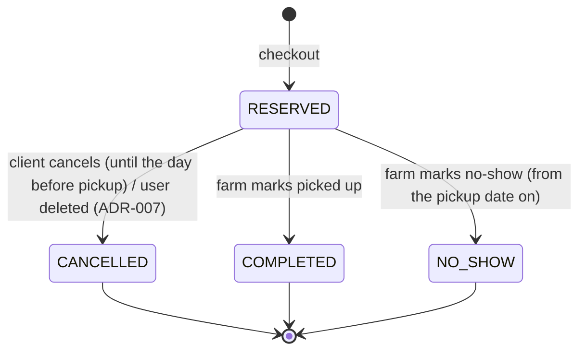

# ADR-004: Check out as one transaction that creates one order per farm with an atomic conditional stock decrement

| | |
|---|---|
| **Status** | Proposed (waiting on Q3 multi-farm cart, Q4 pickup dates, Q6 cancel/complete) |
| **Date** | 2026-10-27 |
| **Deciders** | michaljaros, with Claude as architecture consultant |
| **System** | Not Far(m) From Home (NFFH) |
| **Requirements** | [../../Tasks/data/NFFH.txt](../../Tasks/data/NFFH.txt) |
| **Analysis** | [../NFFH_architecture_notes.md](../NFFH_architecture_notes.md) §1.3 (C5, C6), QAS1–QAS3, §5.5 checkout sequence |
| **Supersedes** | — |
| **Related** | [ADR-001](ADR-001-modular-monolith.md) §2.6 · [ADR-007](ADR-007-deletion-policy.md) (cancellation on deletion) |

---

## 1. Context

### 1.1 What the system does

Clients reserve farm produce and pick it up at the farm on a chosen day. No money is handled online.

### 1.2 What the requirements contain

| Need | Stories |
|---|---|
| Cart: add, remove, view | 9, 10, 11 |
| Complete an order and choose a pickup date | 12 |
| Farms change price and quantity at any time | 14, 15, 16 |
| Order history for client and farm | 40, 41 |
| Pickup "at the Agricultural Company" | system description |

### 1.3 What the requirements do not contain

* Whether a cart may mix farms (Q3).
* Which pickup dates are allowed (Q4).
* Cancellation, completion, no-show (Q6).
* Whether the cart holds stock.
* What happens when a price changes while an item is in the cart.

### 1.4 Decision drivers

| # | Driver | Weight | Why |
|---|---|:-:|---|
| D1 | Stock never negative, no double-selling | 5 | 12 vs. 16. QAS1 |
| D1b | All-or-nothing checkout | 5 | QAS3 |
| D1c | The client pays the price they saw | 4 | 16. QAS2 |
| D2 | Simple to build and test | 5 | ADR-001 |

## 2. Decision

### 2.1 The cart does not reserve stock

`ordering.cart_item(client_id, product_id, quantity)`. Adding checks only that the product is active, that the quantity is a multiple of the product's step, and that it is ≤ the current available quantity (as a hint, not a guarantee). The cart shows **current** prices. Archived products are removed from carts (ADR-007).

### 2.2 One order per farm (default answer to Q3)

A cart may contain products of several farms. Checkout creates **one order per farm**, because each pickup happens at one farm. The client picks **one pickup date per farm** in the checkout screen. All orders of one checkout share a `checkout_id` for display.

### 2.3 Pickup-date rule (default answer to Q4)

Allowed: from **tomorrow** to **today + 14 days**, and on one of the farm's `pickup_weekdays` if the farm has set any (otherwise any day). The rule is evaluated by `farms.pickupPolicy(farmId)` and checked again on the server at checkout.

### 2.4 The transaction

All steps run in **one** database transaction (allowed by ADR-001 §2.6):

1. `SELECT … FROM ordering.cart_item WHERE client_id = :c FOR UPDATE`. This locks the cart against a double submit. An empty cart → 422.
2. Validate each farm's pickup date (2.3) → 422 on failure.
3. `catalog.reserveStock(lines)`: lines **sorted by product_id**, which keeps lock order consistent and prevents deadlocks. For each line:

   ```sql
   -- catalog schema, executed inside catalog's reserveStock
   UPDATE catalog.product
      SET quantity_available = quantity_available - :qty,
          version = version + 1
    WHERE id = :product_id
      AND status = 'ACTIVE'
      AND quantity_available >= :qty
   RETURNING farm_id, name, unit, price_per_unit;
   ```

   No row returned → the line is short. `reserveStock` collects all short lines and throws `InsufficientStock(lines)`. If all lines succeed, it also increments catalog's own popularity counter per line (ADR-005 §2.3).
4. Compute the total from the returned prices and compare it with `expectedTotal` sent by the client. If they differ → `PriceChanged(newTotal)` (default answer for QAS2).
5. `INSERT` one `ordering.order` per farm (`status = RESERVED`, `pickup_date`, `total`, `farm_name_snapshot`) and its `order_line` rows with **snapshots** of name, unit and unit price.
6. `DELETE` the cart rows.
7. Record `OrderPlaced(orderIds)` in the event publication log and `COMMIT`.

Any exception → `ROLLBACK`. The response is `409` with `{shortLines: [...]}` or `{newTotal}`, and the cart is unchanged.

Self-check:
* The `UPDATE` touches only `catalog` and runs inside the catalog module (rule ADR-001 §2.5).
* The conditional `WHERE` makes the check and the decrement one atomic step, so there is no `SELECT`-then-`UPDATE` race.
* `CHECK (quantity_available >= 0)` on the table is a second safety net.
* Order totals are sums of money (price × quantity per line). Quantities of different units are never summed.

### 2.5 Farm edits during checkout (16)

A farm's `PATCH` of price or quantity is a normal row update. If it runs at the same moment as a checkout, PostgreSQL row locks serialize them. A farm setting `quantity_available` overwrites the *available* amount. Already reserved stock lives in orders and is not affected. Farms see "reserved in open orders" next to "available", so they don't double count.

### 2.6 Order states (default answer to Q6)



* `CANCELLED` calls `catalog.releaseStock(lines)` in the same transaction (an `UPDATE … + :qty` on active products. Archived products are not restocked).
* `NO_SHOW` does **not** return stock automatically, because the produce may have spoiled. The farm adjusts the quantity by hand.
* The cancel, complete and no-show transitions need **new stories**. Until they are approved, only `RESERVED` and system cancellation (ADR-007) are built.

### 2.7 What this ADR does not decide

Payment, reservation expiry, notifications to the farm.

## 3. Options considered

| Sub-question | Option | Verdict |
|---|---|---|
| Where to check stock | **Conditional UPDATE in the transaction** | **Chosen**: atomic, one statement |
| | `SELECT … FOR UPDATE` then `UPDATE` | Correct but more code and longer locks. Runner-up |
| | Optimistic `version` check + retry | More retries under contention on popular items |
| | Check in the app without a lock | Rejected: race condition (QAS1 fails) |
| When to reserve | **At checkout** | **Chosen** |
| | When adding to the cart (with expiry) | Rejected: carts would hold farm stock hostage, and it needs an expiry job |
| Multi-farm cart | **One order per farm, all-or-nothing** | **Chosen** |
| | One order for the whole cart | Rejected: one pickup date can't cover two farms |
| | Allow only one farm per cart | Simpler, but a worse experience. Fallback if the PO says so (Q3) |
| | Partial success (create the orders that fit) | Rejected: surprising, and QAS3 asks for all-or-nothing |
| Price change | **Compare expected total, 409** | **Chosen** |
| | Lock the price at add-to-cart | Rejected: the farm loses control of its price (16) |

## 4. Consequences

### 4.1 Positive

| Consequence | Practical meaning | Driver |
|---|---|---|
| Stock can't go negative | No client drives to a farm for produce that is gone | D1 |
| All-or-nothing | No half-placed checkouts to explain | D1b |
| Price confirmed | No disputes at pickup | D1c |
| One short transaction | Easy to read, easy to test | D2 |

### 4.2 Negative, and how they are handled

| Consequence | Practical meaning | Mitigation | Residual risk |
|---|---|---|---|
| A cart item can turn out unavailable at checkout | Disappointment | Show availability in the cart. A clear 409 message per line | Low |
| One short line blocks the whole checkout | The client must fix the cart | Message offers "remove the unavailable items" | Low |
| No-show stock is not returned | Manual adjustment by the farm | Show a reminder in the farm's order list | Low |

### 4.3 Impact on the people involved

Clients choose one date per farm. Farms see reserved vs. available. Testers own the concurrency test.

### 4.4 Follow-up work

1. Implement `reserveStock` / `releaseStock` in catalog.
2. The checkout service in ordering.
3. Concurrency test.
4. Propose the cancel / complete / no-show stories to the PO.

## 5. Compliance

| Check | How | When |
|---|---|---|
| QAS1 | 50 parallel checkouts on stock 2 → exactly 2 succeed, final stock 0 | Every build |
| QAS3 | Two-farm cart with one short line → 0 orders, stock unchanged | Every build |
| QAS2 | Price changed after the cart was loaded → 409 with the new total | Every build |
| Deadlock-free | Two carts with the same 2 products in opposite order, run in parallel 100× → no deadlock errors | Every build |

## 6. When to revisit

| Trigger | Response |
|---|---|
| Online payment | Add `AWAITING_PAYMENT` before `RESERVED`, with a timeout that releases stock |
| PO answers Q3 "one farm per cart" | Simplify 2.2. The transaction stays |
| Very hot products cause lock contention | Measure first. Then consider queueing checkouts per product |

## 7. Open questions

| # | Question | Current default |
|---|---|---|
| Q3 | Multi-farm cart? | Yes, one order per farm |
| Q4 | Pickup dates? | Tomorrow … +14 days on the farm's pickup weekdays |
| Q6 | Cancel / complete / no-show? | As in 2.6, pending new stories |
| Q16 | Units and steps? | Unit per product, step set by the farm |
